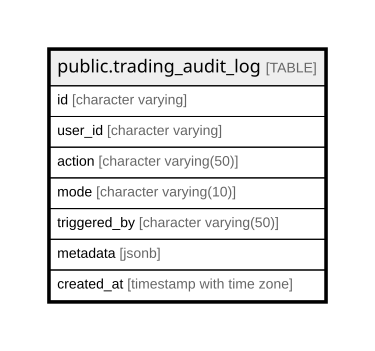

# public.trading_audit_log

## Columns

| Name | Type | Default | Nullable | Children | Parents | Comment |
| ---- | ---- | ------- | -------- | -------- | ------- | ------- |
| id | character varying | gen_random_uuid() | false |  |  |  |
| user_id | character varying |  | false |  |  |  |
| action | character varying(50) |  | false |  |  |  |
| mode | character varying(10) |  | false |  |  |  |
| triggered_by | character varying(50) | 'manual'::character varying | true |  |  |  |
| metadata | jsonb |  | true |  |  |  |
| created_at | timestamp with time zone | now() | false |  |  |  |

## Viewpoints

| Name | Definition |
| ---- | ---------- |
| [public schema](viewpoint-schema-public.md) | All mapped relations in public. |

## Constraints

| Name | Type | Definition |
| ---- | ---- | ---------- |
| trading_audit_log_pkey | PRIMARY KEY | PRIMARY KEY (id) |

## Indexes

| Name | Definition |
| ---- | ---------- |
| trading_audit_log_action_idx | CREATE INDEX trading_audit_log_action_idx ON public.trading_audit_log USING btree (action) |
| trading_audit_log_created_at_idx | CREATE INDEX trading_audit_log_created_at_idx ON public.trading_audit_log USING btree (created_at) |
| trading_audit_log_mode_idx | CREATE INDEX trading_audit_log_mode_idx ON public.trading_audit_log USING btree (mode) |
| trading_audit_log_pkey | CREATE UNIQUE INDEX trading_audit_log_pkey ON public.trading_audit_log USING btree (id) |
| trading_audit_log_user_idx | CREATE INDEX trading_audit_log_user_idx ON public.trading_audit_log USING btree (user_id) |

## Relations

---

> Generated by [tbls](https://github.com/k1LoW/tbls)
