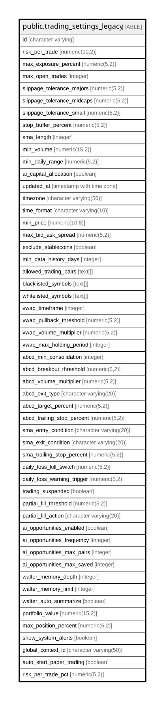

# public.trading_settings_legacy

## Columns

| Name | Type | Default | Nullable | Children | Parents | Comment |
| ---- | ---- | ------- | -------- | -------- | ------- | ------- |
| id | character varying | gen_random_uuid() | false |  |  |  |
| risk_per_trade | numeric(10,2) | 150.00 | true |  |  |  |
| max_exposure_percent | numeric(5,2) | 25.00 | true |  |  |  |
| max_open_trades | integer | 3 | true |  |  |  |
| slippage_tolerance_majors | numeric(5,2) | 0.50 | true |  |  |  |
| slippage_tolerance_midcaps | numeric(5,2) | 2.00 | true |  |  |  |
| slippage_tolerance_small | numeric(5,2) | 5.00 | true |  |  |  |
| stop_buffer_percent | numeric(5,2) | 0.30 | true |  |  |  |
| sma_length | integer | 20 | true |  |  |  |
| min_volume | numeric(15,2) | 30000000.00 | true |  |  |  |
| min_daily_range | numeric(5,2) | 6.50 | true |  |  |  |
| ai_capital_allocation | boolean | false | true |  |  |  |
| updated_at | timestamp with time zone | now() | true |  |  |  |
| timezone | character varying(50) | 'Asia/Dubai'::character varying | true |  |  |  |
| time_format | character varying(10) | '12hr'::character varying | true |  |  |  |
| min_price | numeric(10,8) | 0.01 | true |  |  |  |
| max_bid_ask_spread | numeric(5,2) | 1.00 | true |  |  |  |
| exclude_stablecoins | boolean | true | true |  |  |  |
| min_data_history_days | integer | 90 | true |  |  |  |
| allowed_trading_pairs | text[] | ARRAY['USD'::text, 'USDT'::text] | true |  |  |  |
| blacklisted_symbols | text[] | ARRAY[]::text[] | true |  |  |  |
| whitelisted_symbols | text[] | ARRAY[]::text[] | true |  |  |  |
| vwap_timeframe | integer | 60 | true |  |  |  |
| vwap_pullback_threshold | numeric(5,2) | 2.00 | true |  |  |  |
| vwap_volume_multiplier | numeric(5,2) | 1.50 | true |  |  |  |
| vwap_max_holding_period | integer | 24 | true |  |  |  |
| abcd_min_consolidation | integer | 10 | true |  |  |  |
| abcd_breakout_threshold | numeric(5,2) | 1.50 | true |  |  |  |
| abcd_volume_multiplier | numeric(5,2) | 1.50 | true |  |  |  |
| abcd_exit_type | character varying(20) | 'target'::character varying | true |  |  |  |
| abcd_target_percent | numeric(5,2) | 3.00 | true |  |  |  |
| abcd_trailing_stop_percent | numeric(5,2) | 2.00 | true |  |  |  |
| sma_entry_condition | character varying(20) | 'crossover'::character varying | true |  |  |  |
| sma_exit_condition | character varying(20) | 'break'::character varying | true |  |  |  |
| sma_trailing_stop_percent | numeric(5,2) | 2.00 | true |  |  |  |
| daily_loss_kill_switch | numeric(5,2) | 7.00 | true |  |  |  |
| daily_loss_warning_trigger | numeric(5,2) | 75.00 | true |  |  |  |
| trading_suspended | boolean | false | true |  |  |  |
| partial_fill_threshold | numeric(5,2) | 90.00 | true |  |  |  |
| partial_fill_action | character varying(20) | 'scale'::character varying | true |  |  |  |
| ai_opportunities_enabled | boolean | true | true |  |  |  |
| ai_opportunities_frequency | integer | 60 | true |  |  |  |
| ai_opportunities_max_pairs | integer | 150 | true |  |  |  |
| ai_opportunities_max_saved | integer | 40 | true |  |  |  |
| walter_memory_depth | integer | 20 | true |  |  |  |
| walter_memory_limit | integer | 500 | true |  |  |  |
| walter_auto_summarize | boolean | true | true |  |  |  |
| portfolio_value | numeric(15,2) | 50000.00 | true |  |  |  |
| max_position_percent | numeric(5,2) | 10.00 | true |  |  |  |
| show_system_alerts | boolean | true | true |  |  |  |
| global_context_id | character varying(50) | 'default'::character varying | false |  |  |  |
| auto_start_paper_trading | boolean | false | true |  |  |  |
| risk_per_trade_pct | numeric(5,2) | 4.00 | true |  |  |  |

## Viewpoints

| Name | Definition |
| ---- | ---------- |
| [public schema](viewpoint-schema-public.md) | All mapped relations in public. |

## Constraints

| Name | Type | Definition |
| ---- | ---- | ---------- |
| trading_settings_pkey | PRIMARY KEY | PRIMARY KEY (id) |

## Indexes

| Name | Definition |
| ---- | ---------- |
| trading_settings_pkey | CREATE UNIQUE INDEX trading_settings_pkey ON public.trading_settings_legacy USING btree (id) |

## Relations

---

> Generated by [tbls](https://github.com/k1LoW/tbls)
