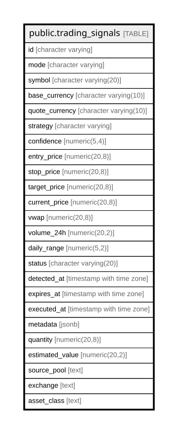

# public.trading_signals

## Columns

| Name | Type | Default | Nullable | Children | Parents | Comment |
| ---- | ---- | ------- | -------- | -------- | ------- | ------- |
| id | character varying | gen_random_uuid() | false |  |  |  |
| mode | character varying | 'paper'::character varying | false |  |  |  |
| symbol | character varying(20) |  | false |  |  |  |
| base_currency | character varying(10) |  | false |  |  |  |
| quote_currency | character varying(10) |  | false |  |  |  |
| strategy | character varying |  | false |  |  |  |
| confidence | numeric(5,4) |  | false |  |  |  |
| entry_price | numeric(20,8) |  | false |  |  |  |
| stop_price | numeric(20,8) |  | false |  |  |  |
| target_price | numeric(20,8) |  | false |  |  |  |
| current_price | numeric(20,8) |  | false |  |  |  |
| vwap | numeric(20,8) |  | true |  |  |  |
| volume_24h | numeric(20,2) |  | true |  |  |  |
| daily_range | numeric(5,2) |  | true |  |  |  |
| status | character varying(20) | 'active'::character varying | false |  |  |  |
| detected_at | timestamp with time zone | now() | true |  |  |  |
| expires_at | timestamp with time zone |  | true |  |  |  |
| executed_at | timestamp with time zone |  | true |  |  |  |
| metadata | jsonb |  | true |  |  |  |
| quantity | numeric(20,8) |  | true |  |  |  |
| estimated_value | numeric(20,2) |  | true |  |  |  |
| source_pool | text |  | true |  |  |  |
| exchange | text | 'kraken'::text | false |  |  |  |
| asset_class | text | 'crypto_spot'::text | false |  |  |  |

## Viewpoints

| Name | Definition |
| ---- | ---------- |
| [public schema](viewpoint-schema-public.md) | All mapped relations in public. |

## Constraints

| Name | Type | Definition |
| ---- | ---- | ---------- |
| trading_signals_pkey | PRIMARY KEY | PRIMARY KEY (id) |

## Indexes

| Name | Definition |
| ---- | ---------- |
| ix_trading_signals_expires_at | CREATE INDEX ix_trading_signals_expires_at ON public.trading_signals USING btree (expires_at) |
| ix_trading_signals_mode_status | CREATE INDEX ix_trading_signals_mode_status ON public.trading_signals USING btree (mode, status) |
| trading_signals_detected_at_idx | CREATE INDEX trading_signals_detected_at_idx ON public.trading_signals USING btree (detected_at) |
| trading_signals_pkey | CREATE UNIQUE INDEX trading_signals_pkey ON public.trading_signals USING btree (id) |
| trading_signals_symbol_strategy_idx | CREATE INDEX trading_signals_symbol_strategy_idx ON public.trading_signals USING btree (symbol, strategy) |
| ux_trading_signals_mode_symbol_strategy | CREATE UNIQUE INDEX ux_trading_signals_mode_symbol_strategy ON public.trading_signals USING btree (mode, symbol, strategy, status) WHERE ((status)::text = 'active'::text) |

## Relations

---

> Generated by [tbls](https://github.com/k1LoW/tbls)
