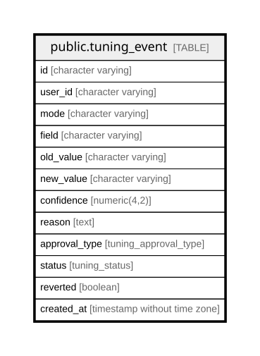

# public.tuning_event

## Columns

| Name | Type | Default | Nullable | Children | Parents | Comment |
| ---- | ---- | ------- | -------- | -------- | ------- | ------- |
| id | character varying | gen_random_uuid() | false |  |  |  |
| user_id | character varying |  | false |  |  |  |
| mode | character varying |  | false |  |  |  |
| field | character varying |  | false |  |  |  |
| old_value | character varying |  | false |  |  |  |
| new_value | character varying |  | false |  |  |  |
| confidence | numeric(4,2) |  | false |  |  |  |
| reason | text |  | false |  |  |  |
| approval_type | tuning_approval_type |  | false |  |  |  |
| status | tuning_status |  | false |  |  |  |
| reverted | boolean | false | false |  |  |  |
| created_at | timestamp without time zone | CURRENT_TIMESTAMP | false |  |  |  |

## Viewpoints

| Name | Definition |
| ---- | ---------- |
| [public schema](viewpoint-schema-public.md) | All mapped relations in public. |

## Constraints

| Name | Type | Definition |
| ---- | ---- | ---------- |
| tuning_event_pkey | PRIMARY KEY | PRIMARY KEY (id) |

## Indexes

| Name | Definition |
| ---- | ---------- |
| idx_tuning_event_created_at | CREATE INDEX idx_tuning_event_created_at ON public.tuning_event USING btree (created_at DESC) |
| idx_tuning_event_user_mode | CREATE INDEX idx_tuning_event_user_mode ON public.tuning_event USING btree (user_id, mode) |
| tuning_event_pkey | CREATE UNIQUE INDEX tuning_event_pkey ON public.tuning_event USING btree (id) |

## Relations

---

> Generated by [tbls](https://github.com/k1LoW/tbls)
