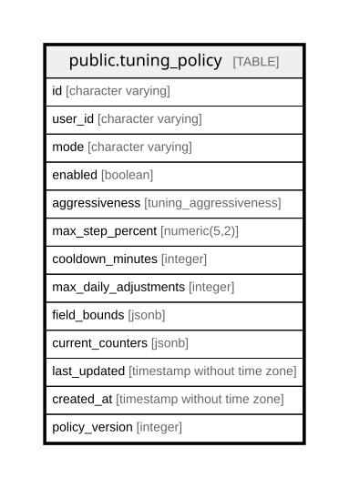

# public.tuning_policy

## Columns

| Name | Type | Default | Nullable | Children | Parents | Comment |
| ---- | ---- | ------- | -------- | -------- | ------- | ------- |
| id | character varying | gen_random_uuid() | false |  |  |  |
| user_id | character varying |  | false |  |  |  |
| mode | character varying |  | false |  |  |  |
| enabled | boolean | false | false |  |  |  |
| aggressiveness | tuning_aggressiveness | 'balanced'::tuning_aggressiveness | false |  |  |  |
| max_step_percent | numeric(5,2) | 10.00 | false |  |  |  |
| cooldown_minutes | integer | 60 | false |  |  |  |
| max_daily_adjustments | integer | 10 | false |  |  |  |
| field_bounds | jsonb | '{}'::jsonb | false |  |  |  |
| current_counters | jsonb | '{"reverts": 0, "adjustmentsToday": 0}'::jsonb | false |  |  |  |
| last_updated | timestamp without time zone | CURRENT_TIMESTAMP | false |  |  |  |
| created_at | timestamp without time zone | CURRENT_TIMESTAMP | false |  |  |  |
| policy_version | integer | 1 | false |  |  |  |

## Viewpoints

| Name | Definition |
| ---- | ---------- |
| [public schema](viewpoint-schema-public.md) | All mapped relations in public. |

## Constraints

| Name | Type | Definition |
| ---- | ---- | ---------- |
| tuning_policy_pkey | PRIMARY KEY | PRIMARY KEY (id) |
| tuning_policy_user_id_mode_key | UNIQUE | UNIQUE (user_id, mode) |
| tuning_policy_user_mode_unique | UNIQUE | UNIQUE (user_id, mode) |

## Indexes

| Name | Definition |
| ---- | ---------- |
| idx_tuning_policy_user_mode | CREATE INDEX idx_tuning_policy_user_mode ON public.tuning_policy USING btree (user_id, mode) |
| tuning_policy_pkey | CREATE UNIQUE INDEX tuning_policy_pkey ON public.tuning_policy USING btree (id) |
| tuning_policy_user_id_mode_key | CREATE UNIQUE INDEX tuning_policy_user_id_mode_key ON public.tuning_policy USING btree (user_id, mode) |
| tuning_policy_user_mode_unique | CREATE UNIQUE INDEX tuning_policy_user_mode_unique ON public.tuning_policy USING btree (user_id, mode) |

## Relations

---

> Generated by [tbls](https://github.com/k1LoW/tbls)
