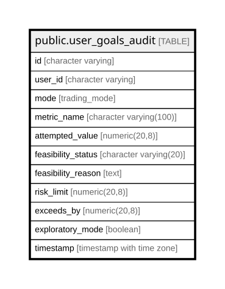

# public.user_goals_audit

## Columns

| Name | Type | Default | Nullable | Children | Parents | Comment |
| ---- | ---- | ------- | -------- | -------- | ------- | ------- |
| id | character varying | gen_random_uuid() | false |  |  |  |
| user_id | character varying |  | true |  |  |  |
| mode | trading_mode |  | false |  |  |  |
| metric_name | character varying(100) |  | false |  |  |  |
| attempted_value | numeric(20,8) |  | false |  |  |  |
| feasibility_status | character varying(20) |  | false |  |  |  |
| feasibility_reason | text |  | true |  |  |  |
| risk_limit | numeric(20,8) |  | true |  |  |  |
| exceeds_by | numeric(20,8) |  | true |  |  |  |
| exploratory_mode | boolean | false | true |  |  |  |
| timestamp | timestamp with time zone | now() | true |  |  |  |

## Viewpoints

| Name | Definition |
| ---- | ---------- |
| [public schema](viewpoint-schema-public.md) | All mapped relations in public. |

## Constraints

| Name | Type | Definition |
| ---- | ---- | ---------- |
| user_goals_audit_pkey | PRIMARY KEY | PRIMARY KEY (id) |

## Indexes

| Name | Definition |
| ---- | ---------- |
| user_goals_audit_pkey | CREATE UNIQUE INDEX user_goals_audit_pkey ON public.user_goals_audit USING btree (id) |
| user_goals_audit_status_idx | CREATE INDEX user_goals_audit_status_idx ON public.user_goals_audit USING btree (feasibility_status) |
| user_goals_audit_timestamp_idx | CREATE INDEX user_goals_audit_timestamp_idx ON public.user_goals_audit USING btree ("timestamp") |
| user_goals_audit_user_id_idx | CREATE INDEX user_goals_audit_user_id_idx ON public.user_goals_audit USING btree (user_id) |

## Relations

---

> Generated by [tbls](https://github.com/k1LoW/tbls)
