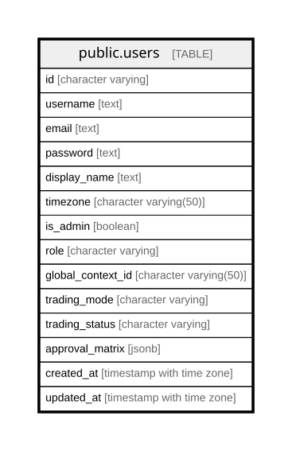

# public.users

## Columns

| Name | Type | Default | Nullable | Children | Parents | Comment |
| ---- | ---- | ------- | -------- | -------- | ------- | ------- |
| id | character varying | gen_random_uuid() | false |  |  |  |
| username | text |  | false |  |  |  |
| email | text |  | false |  |  |  |
| password | text |  | true |  |  |  |
| display_name | text |  | true |  |  |  |
| timezone | character varying(50) | 'UTC'::character varying | true |  |  |  |
| is_admin | boolean | false | false |  |  |  |
| role | character varying | 'owner'::character varying | false |  |  |  |
| global_context_id | character varying(50) | 'default'::character varying | false |  |  |  |
| trading_mode | character varying | 'paper'::character varying | true |  |  |  |
| trading_status | character varying | 'stopped'::character varying | true |  |  |  |
| approval_matrix | jsonb | '{"autoExecute": {"adjustGoals": true, "deployStrategies": true, "modifyGuardrails": false, "startLiveTrading": true}, "requiresApproval": {"editStrategy": false, "stopLiveTrading": false, "editRiskSettings": true, "changeTradingMode": false}}'::jsonb | true |  |  |  |
| created_at | timestamp with time zone | now() | true |  |  |  |
| updated_at | timestamp with time zone | now() | true |  |  |  |

## Viewpoints

| Name | Definition |
| ---- | ---------- |
| [public schema](viewpoint-schema-public.md) | All mapped relations in public. |

## Constraints

| Name | Type | Definition |
| ---- | ---- | ---------- |
| users_email_key | UNIQUE | UNIQUE (email) |
| users_pkey | PRIMARY KEY | PRIMARY KEY (id) |
| users_username_key | UNIQUE | UNIQUE (username) |

## Indexes

| Name | Definition |
| ---- | ---------- |
| users_email_key | CREATE UNIQUE INDEX users_email_key ON public.users USING btree (email) |
| users_pkey | CREATE UNIQUE INDEX users_pkey ON public.users USING btree (id) |
| users_username_key | CREATE UNIQUE INDEX users_username_key ON public.users USING btree (username) |

## Relations

---

> Generated by [tbls](https://github.com/k1LoW/tbls)
