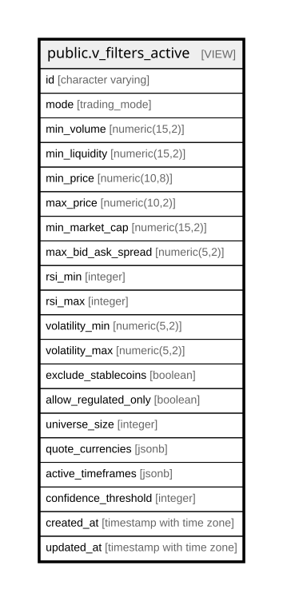

# public.v_filters_active

## Columns

| Name | Type | Default | Nullable | Children | Parents | Comment |
| ---- | ---- | ------- | -------- | -------- | ------- | ------- |
| id | character varying |  | true |  |  |  |
| mode | trading_mode |  | true |  |  |  |
| min_volume | numeric(15,2) |  | true |  |  |  |
| min_liquidity | numeric(15,2) |  | true |  |  |  |
| min_price | numeric(10,8) |  | true |  |  |  |
| max_price | numeric(10,2) |  | true |  |  |  |
| min_market_cap | numeric(15,2) |  | true |  |  |  |
| max_bid_ask_spread | numeric(5,2) |  | true |  |  |  |
| rsi_min | integer |  | true |  |  |  |
| rsi_max | integer |  | true |  |  |  |
| volatility_min | numeric(5,2) |  | true |  |  |  |
| volatility_max | numeric(5,2) |  | true |  |  |  |
| exclude_stablecoins | boolean |  | true |  |  |  |
| allow_regulated_only | boolean |  | true |  |  |  |
| universe_size | integer |  | true |  |  |  |
| quote_currencies | jsonb |  | true |  |  |  |
| active_timeframes | jsonb |  | true |  |  |  |
| confidence_threshold | integer |  | true |  |  |  |
| created_at | timestamp with time zone |  | true |  |  |  |
| updated_at | timestamp with time zone |  | true |  |  |  |

## Viewpoints

| Name | Definition |
| ---- | ---------- |
| [public schema](viewpoint-schema-public.md) | All mapped relations in public. |

## Relations

---

> Generated by [tbls](https://github.com/k1LoW/tbls)
