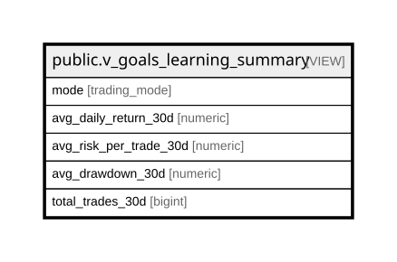

# public.v_goals_learning_summary

## Columns

| Name | Type | Default | Nullable | Children | Parents | Comment |
| ---- | ---- | ------- | -------- | -------- | ------- | ------- |
| mode | trading_mode |  | true |  |  |  |
| avg_daily_return_30d | numeric |  | true |  |  |  |
| avg_risk_per_trade_30d | numeric |  | true |  |  |  |
| avg_drawdown_30d | numeric |  | true |  |  |  |
| total_trades_30d | bigint |  | true |  |  |  |

## Viewpoints

| Name | Definition |
| ---- | ---------- |
| [public schema](viewpoint-schema-public.md) | All mapped relations in public. |

## Relations

---

> Generated by [tbls](https://github.com/k1LoW/tbls)
