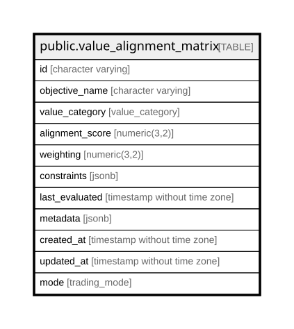

# public.value_alignment_matrix

## Columns

| Name | Type | Default | Nullable | Children | Parents | Comment |
| ---- | ---- | ------- | -------- | -------- | ------- | ------- |
| id | character varying | (gen_random_uuid())::text | false |  |  |  |
| objective_name | character varying |  | false |  |  |  |
| value_category | value_category |  | false |  |  |  |
| alignment_score | numeric(3,2) |  | false |  |  |  |
| weighting | numeric(3,2) | 1.00 | false |  |  |  |
| constraints | jsonb |  | true |  |  |  |
| last_evaluated | timestamp without time zone |  | true |  |  |  |
| metadata | jsonb |  | true |  |  |  |
| created_at | timestamp without time zone | now() | true |  |  |  |
| updated_at | timestamp without time zone | now() | true |  |  |  |
| mode | trading_mode |  | false |  |  |  |

## Viewpoints

| Name | Definition |
| ---- | ---------- |
| [public schema](viewpoint-schema-public.md) | All mapped relations in public. |

## Constraints

| Name | Type | Definition |
| ---- | ---- | ---------- |
| value_alignment_matrix_pkey | PRIMARY KEY | PRIMARY KEY (id) |

## Indexes

| Name | Definition |
| ---- | ---------- |
| value_alignment_matrix_mode_objective_idx | CREATE INDEX value_alignment_matrix_mode_objective_idx ON public.value_alignment_matrix USING btree (mode, objective_name) |
| value_alignment_matrix_pkey | CREATE UNIQUE INDEX value_alignment_matrix_pkey ON public.value_alignment_matrix USING btree (id) |

## Relations

---

> Generated by [tbls](https://github.com/k1LoW/tbls)
