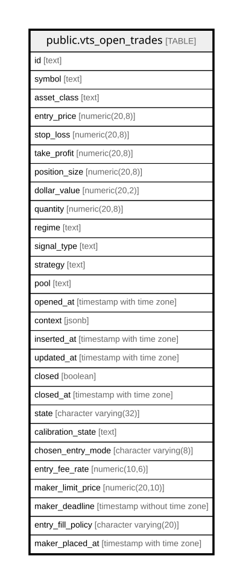

# public.vts_open_trades

## Description

B79.0g — durable open VTS trade rows; written at trade-open, deleted at trade-close inside the same transaction that inserts the closed-trade row into paper_sim_trades. Rehydrated into the in-memory openVirtualTrades Map at server boot.

## Columns

| Name | Type | Default | Nullable | Children | Parents | Comment |
| ---- | ---- | ------- | -------- | -------- | ------- | ------- |
| id | text |  | false |  |  |  |
| symbol | text |  | false |  |  |  |
| asset_class | text |  | false |  |  |  |
| entry_price | numeric(20,8) |  | false |  |  |  |
| stop_loss | numeric(20,8) |  | false |  |  |  |
| take_profit | numeric(20,8) |  | false |  |  |  |
| position_size | numeric(20,8) |  | false |  |  |  |
| dollar_value | numeric(20,2) |  | false |  |  |  |
| quantity | numeric(20,8) |  | false |  |  |  |
| regime | text |  | false |  |  |  |
| signal_type | text |  | false |  |  |  |
| strategy | text |  | false |  |  |  |
| pool | text |  | false |  |  |  |
| opened_at | timestamp with time zone |  | false |  |  |  |
| context | jsonb | '{}'::jsonb | false |  |  |  |
| inserted_at | timestamp with time zone | now() | false |  |  |  |
| updated_at | timestamp with time zone | now() | false |  |  |  |
| closed | boolean | false | false |  |  | B79.0g-tx — soft-delete flag. Open trades have closed=false. Trade-close UPDATE flips to true with closed_at=NOW(). Boot-time sweep DELETEs rows past data_lifecycle.vts_open_trades.closed_gc_retention_days. |
| closed_at | timestamp with time zone |  | true |  |  | B79.0g-tx — wall-clock timestamp of the soft-delete UPDATE. NULL while the trade is open. |
| state | character varying(32) | 'open'::character varying | false |  |  | B-NEW-36 (2026-05-20): lifecycle marker. Values: open \| weekend_suspended \| closed. CHECK constraint vts_open_trades_state_consistency enforces closed↔state AND state↔asset_class (weekend_suspended xstock_spot-only). New code reads `state`; `closed` boolean preserved for backward compat (kept in sync via markOpenTradeClosed). |
| calibration_state | text | 'pre_calibration_xstock_2026_05'::text | false |  |  | B-XSTOCK-CALIB F-NOW (2026-06-01): calibration-era marker. Default 'pre_calibration_xstock_2026_05' tags every trade opened during the xStock calibration umbrella. Phase 25 excludes this cohort from xStock closed-outcome evaluation. Propagated to exit_strategy_alternates by the replay writer. The flip to a post-calibration value is a future action (clean-dataset boundary). |
| chosen_entry_mode | character varying(8) |  | true |  |  |  |
| entry_fee_rate | numeric(10,6) |  | true |  |  |  |
| maker_limit_price | numeric(20,10) |  | true |  |  |  |
| maker_deadline | timestamp without time zone |  | true |  |  |  |
| entry_fill_policy | character varying(20) |  | true |  |  |  |
| maker_placed_at | timestamp with time zone |  | true |  |  |  |

## Viewpoints

| Name | Definition |
| ---- | ---------- |
| [public schema](viewpoint-schema-public.md) | All mapped relations in public. |

## Constraints

| Name | Type | Definition |
| ---- | ---- | ---------- |
| vts_open_trades_pkey | PRIMARY KEY | PRIMARY KEY (id) |
| vts_open_trades_state_consistency | CHECK | CHECK ((closed = false AND (state::text = ANY (ARRAY['open'::character varying, 'weekend_suspended'::character varying, 'pending'::character varying]::text[])) OR closed = true AND state::text = 'closed'::text) AND (state::text <> 'weekend_suspended'::text OR asset_class = 'xstock_spot'::text)) |

## Indexes

| Name | Definition |
| ---- | ---------- |
| vts_open_trades_asset_class_idx | CREATE INDEX vts_open_trades_asset_class_idx ON public.vts_open_trades USING btree (asset_class) |
| vts_open_trades_closed_at_closed_idx | CREATE INDEX vts_open_trades_closed_at_closed_idx ON public.vts_open_trades USING btree (closed_at) WHERE (closed = true) |
| vts_open_trades_open_filter_idx | CREATE INDEX vts_open_trades_open_filter_idx ON public.vts_open_trades USING btree (id) WHERE (closed = false) |
| vts_open_trades_opened_at_idx | CREATE INDEX vts_open_trades_opened_at_idx ON public.vts_open_trades USING btree (opened_at) |
| vts_open_trades_pkey | CREATE UNIQUE INDEX vts_open_trades_pkey ON public.vts_open_trades USING btree (id) |
| vts_open_trades_symbol_idx | CREATE INDEX vts_open_trades_symbol_idx ON public.vts_open_trades USING btree (symbol) |

## Relations

---

> Generated by [tbls](https://github.com/k1LoW/tbls)
