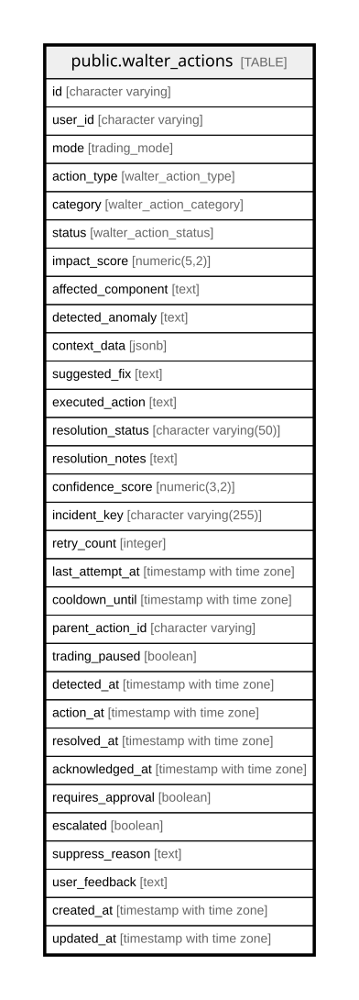

# public.walter_actions

## Columns

| Name | Type | Default | Nullable | Children | Parents | Comment |
| ---- | ---- | ------- | -------- | -------- | ------- | ------- |
| id | character varying | gen_random_uuid() | false |  |  |  |
| user_id | character varying |  | false |  |  |  |
| mode | trading_mode |  | false |  |  |  |
| action_type | walter_action_type |  | false |  |  |  |
| category | walter_action_category |  | false |  |  |  |
| status | walter_action_status | 'pending'::walter_action_status | false |  |  |  |
| impact_score | numeric(5,2) |  | false |  |  |  |
| affected_component | text |  | false |  |  |  |
| detected_anomaly | text |  | false |  |  |  |
| context_data | jsonb |  | true |  |  |  |
| suggested_fix | text |  | false |  |  |  |
| executed_action | text |  | true |  |  |  |
| resolution_status | character varying(50) |  | true |  |  |  |
| resolution_notes | text |  | true |  |  |  |
| confidence_score | numeric(3,2) |  | true |  |  |  |
| incident_key | character varying(255) |  | false |  |  |  |
| retry_count | integer | 0 | false |  |  |  |
| last_attempt_at | timestamp with time zone |  | true |  |  |  |
| cooldown_until | timestamp with time zone |  | true |  |  |  |
| parent_action_id | character varying |  | true |  |  |  |
| trading_paused | boolean | false | false |  |  |  |
| detected_at | timestamp with time zone | now() | true |  |  |  |
| action_at | timestamp with time zone |  | true |  |  |  |
| resolved_at | timestamp with time zone |  | true |  |  |  |
| acknowledged_at | timestamp with time zone |  | true |  |  |  |
| requires_approval | boolean | false | false |  |  |  |
| escalated | boolean | false | false |  |  |  |
| suppress_reason | text |  | true |  |  |  |
| user_feedback | text |  | true |  |  |  |
| created_at | timestamp with time zone | now() | true |  |  |  |
| updated_at | timestamp with time zone | now() | true |  |  |  |

## Viewpoints

| Name | Definition |
| ---- | ---------- |
| [public schema](viewpoint-schema-public.md) | All mapped relations in public. |

## Constraints

| Name | Type | Definition |
| ---- | ---- | ---------- |
| walter_actions_pkey | PRIMARY KEY | PRIMARY KEY (id) |

## Indexes

| Name | Definition |
| ---- | ---------- |
| walter_actions_category_idx | CREATE INDEX walter_actions_category_idx ON public.walter_actions USING btree (category) |
| walter_actions_detected_at_idx | CREATE INDEX walter_actions_detected_at_idx ON public.walter_actions USING btree (detected_at) |
| walter_actions_escalated_idx | CREATE INDEX walter_actions_escalated_idx ON public.walter_actions USING btree (escalated) |
| walter_actions_impact_idx | CREATE INDEX walter_actions_impact_idx ON public.walter_actions USING btree (impact_score) |
| walter_actions_incident_key_idx | CREATE INDEX walter_actions_incident_key_idx ON public.walter_actions USING btree (incident_key) |
| walter_actions_parent_action_idx | CREATE INDEX walter_actions_parent_action_idx ON public.walter_actions USING btree (parent_action_id) |
| walter_actions_pkey | CREATE UNIQUE INDEX walter_actions_pkey ON public.walter_actions USING btree (id) |
| walter_actions_status_idx | CREATE INDEX walter_actions_status_idx ON public.walter_actions USING btree (status) |
| walter_actions_user_mode_idx | CREATE INDEX walter_actions_user_mode_idx ON public.walter_actions USING btree (user_id, mode) |

## Relations

---

> Generated by [tbls](https://github.com/k1LoW/tbls)
