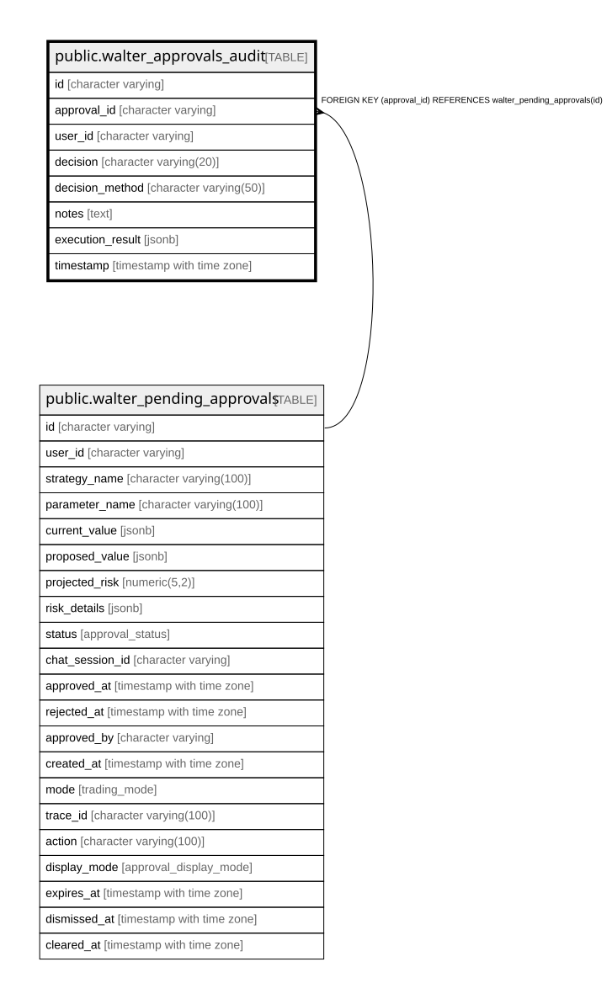

# public.walter_approvals_audit

## Columns

| Name | Type | Default | Nullable | Children | Parents | Comment |
| ---- | ---- | ------- | -------- | -------- | ------- | ------- |
| id | character varying | gen_random_uuid() | false |  |  |  |
| approval_id | character varying |  | false |  | [public.walter_pending_approvals](public.walter_pending_approvals.md) |  |
| user_id | character varying |  | false |  |  |  |
| decision | character varying(20) |  | false |  |  |  |
| decision_method | character varying(50) |  | true |  |  |  |
| notes | text |  | true |  |  |  |
| execution_result | jsonb |  | true |  |  |  |
| timestamp | timestamp with time zone | now() | true |  |  |  |

## Viewpoints

| Name | Definition |
| ---- | ---------- |
| [public schema](viewpoint-schema-public.md) | All mapped relations in public. |

## Constraints

| Name | Type | Definition |
| ---- | ---- | ---------- |
| walter_approvals_audit_approval_id_walter_pending_approvals_id_ | FOREIGN KEY | FOREIGN KEY (approval_id) REFERENCES walter_pending_approvals(id) |
| walter_approvals_audit_pkey | PRIMARY KEY | PRIMARY KEY (id) |

## Indexes

| Name | Definition |
| ---- | ---------- |
| walter_approvals_audit_approval_idx | CREATE INDEX walter_approvals_audit_approval_idx ON public.walter_approvals_audit USING btree (approval_id) |
| walter_approvals_audit_pkey | CREATE UNIQUE INDEX walter_approvals_audit_pkey ON public.walter_approvals_audit USING btree (id) |
| walter_approvals_audit_timestamp_idx | CREATE INDEX walter_approvals_audit_timestamp_idx ON public.walter_approvals_audit USING btree ("timestamp") |
| walter_approvals_audit_user_idx | CREATE INDEX walter_approvals_audit_user_idx ON public.walter_approvals_audit USING btree (user_id) |

## Relations

---

> Generated by [tbls](https://github.com/k1LoW/tbls)
