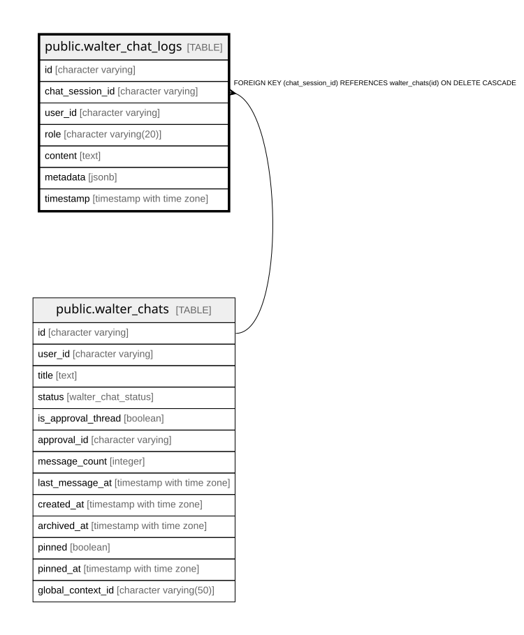

# public.walter_chat_logs

## Columns

| Name | Type | Default | Nullable | Children | Parents | Comment |
| ---- | ---- | ------- | -------- | -------- | ------- | ------- |
| id | character varying | gen_random_uuid() | false |  |  |  |
| chat_session_id | character varying |  | false |  | [public.walter_chats](public.walter_chats.md) |  |
| user_id | character varying |  | false |  |  |  |
| role | character varying(20) |  | false |  |  |  |
| content | text |  | false |  |  |  |
| metadata | jsonb |  | true |  |  |  |
| timestamp | timestamp with time zone | now() | true |  |  |  |

## Viewpoints

| Name | Definition |
| ---- | ---------- |
| [public schema](viewpoint-schema-public.md) | All mapped relations in public. |

## Constraints

| Name | Type | Definition |
| ---- | ---- | ---------- |
| walter_chat_logs_chat_session_id_walter_chats_id_fk | FOREIGN KEY | FOREIGN KEY (chat_session_id) REFERENCES walter_chats(id) ON DELETE CASCADE |
| walter_chat_logs_pkey | PRIMARY KEY | PRIMARY KEY (id) |

## Indexes

| Name | Definition |
| ---- | ---------- |
| walter_chat_logs_pkey | CREATE UNIQUE INDEX walter_chat_logs_pkey ON public.walter_chat_logs USING btree (id) |
| walter_chat_logs_session_idx | CREATE INDEX walter_chat_logs_session_idx ON public.walter_chat_logs USING btree (chat_session_id) |
| walter_chat_logs_timestamp_idx | CREATE INDEX walter_chat_logs_timestamp_idx ON public.walter_chat_logs USING btree ("timestamp") |

## Relations

---

> Generated by [tbls](https://github.com/k1LoW/tbls)
