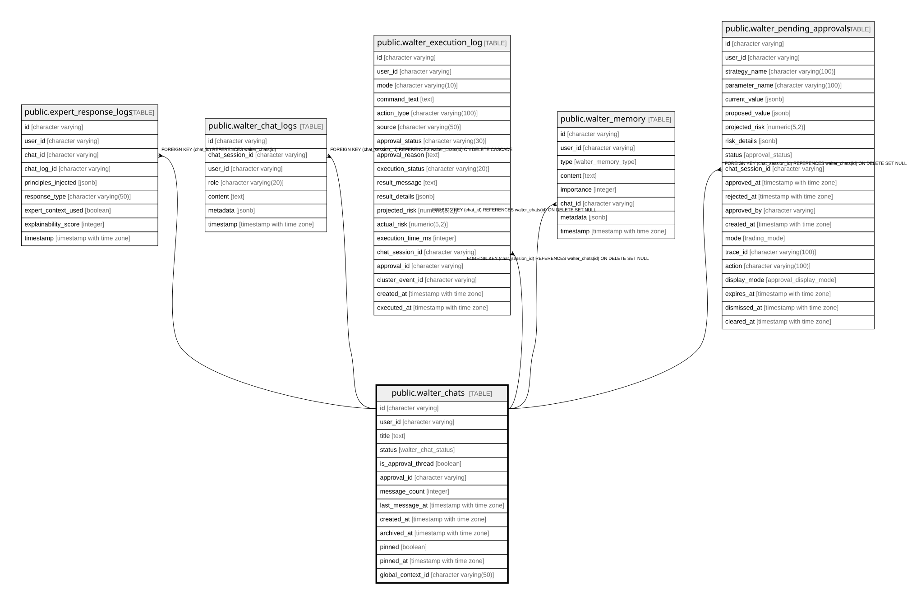

# public.walter_chats

## Columns

| Name | Type | Default | Nullable | Children | Parents | Comment |
| ---- | ---- | ------- | -------- | -------- | ------- | ------- |
| id | character varying | gen_random_uuid() | false | [public.expert_response_logs](public.expert_response_logs.md) [public.walter_chat_logs](public.walter_chat_logs.md) [public.walter_execution_log](public.walter_execution_log.md) [public.walter_memory](public.walter_memory.md) [public.walter_pending_approvals](public.walter_pending_approvals.md) |  |  |
| user_id | character varying |  | true |  |  |  |
| title | text | 'New Chat'::text | true |  |  |  |
| status | walter_chat_status | 'active'::walter_chat_status | true |  |  |  |
| is_approval_thread | boolean | false | true |  |  |  |
| approval_id | character varying |  | true |  |  |  |
| message_count | integer | 0 | true |  |  |  |
| last_message_at | timestamp with time zone |  | true |  |  |  |
| created_at | timestamp with time zone | now() | true |  |  |  |
| archived_at | timestamp with time zone |  | true |  |  |  |
| pinned | boolean | false | false |  |  |  |
| pinned_at | timestamp with time zone |  | true |  |  |  |
| global_context_id | character varying(50) | 'default'::character varying | false |  |  |  |

## Viewpoints

| Name | Definition |
| ---- | ---------- |
| [public schema](viewpoint-schema-public.md) | All mapped relations in public. |

## Constraints

| Name | Type | Definition |
| ---- | ---- | ---------- |
| walter_chats_pkey | PRIMARY KEY | PRIMARY KEY (id) |

## Indexes

| Name | Definition |
| ---- | ---------- |
| walter_chats_pkey | CREATE UNIQUE INDEX walter_chats_pkey ON public.walter_chats USING btree (id) |

## Relations

---

> Generated by [tbls](https://github.com/k1LoW/tbls)
