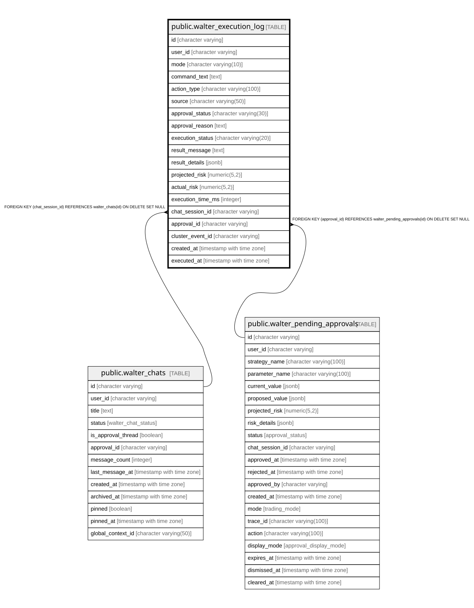

# public.walter_execution_log

## Columns

| Name | Type | Default | Nullable | Children | Parents | Comment |
| ---- | ---- | ------- | -------- | -------- | ------- | ------- |
| id | character varying | gen_random_uuid() | false |  |  |  |
| user_id | character varying |  | false |  |  |  |
| mode | character varying(10) |  | false |  |  |  |
| command_text | text |  | false |  |  |  |
| action_type | character varying(100) |  | false |  |  |  |
| source | character varying(50) |  | false |  |  |  |
| approval_status | character varying(30) |  | false |  |  |  |
| approval_reason | text |  | true |  |  |  |
| execution_status | character varying(20) |  | false |  |  |  |
| result_message | text |  | true |  |  |  |
| result_details | jsonb |  | true |  |  |  |
| projected_risk | numeric(5,2) |  | true |  |  |  |
| actual_risk | numeric(5,2) |  | true |  |  |  |
| execution_time_ms | integer |  | true |  |  |  |
| chat_session_id | character varying |  | true |  | [public.walter_chats](public.walter_chats.md) |  |
| approval_id | character varying |  | true |  | [public.walter_pending_approvals](public.walter_pending_approvals.md) |  |
| cluster_event_id | character varying |  | true |  |  |  |
| created_at | timestamp with time zone | now() | true |  |  |  |
| executed_at | timestamp with time zone |  | true |  |  |  |

## Viewpoints

| Name | Definition |
| ---- | ---------- |
| [public schema](viewpoint-schema-public.md) | All mapped relations in public. |

## Constraints

| Name | Type | Definition |
| ---- | ---- | ---------- |
| walter_execution_log_approval_id_fkey | FOREIGN KEY | FOREIGN KEY (approval_id) REFERENCES walter_pending_approvals(id) ON DELETE SET NULL |
| walter_execution_log_chat_session_id_fkey | FOREIGN KEY | FOREIGN KEY (chat_session_id) REFERENCES walter_chats(id) ON DELETE SET NULL |
| walter_execution_log_mode_check | CHECK | CHECK (mode::text = ANY (ARRAY['live'::character varying::text, 'paper'::character varying::text])) |
| walter_execution_log_pkey | PRIMARY KEY | PRIMARY KEY (id) |

## Indexes

| Name | Definition |
| ---- | ---------- |
| walter_execution_log_action_type_idx | CREATE INDEX walter_execution_log_action_type_idx ON public.walter_execution_log USING btree (action_type) |
| walter_execution_log_created_at_idx | CREATE INDEX walter_execution_log_created_at_idx ON public.walter_execution_log USING btree (created_at) |
| walter_execution_log_mode_idx | CREATE INDEX walter_execution_log_mode_idx ON public.walter_execution_log USING btree (mode) |
| walter_execution_log_pkey | CREATE UNIQUE INDEX walter_execution_log_pkey ON public.walter_execution_log USING btree (id) |
| walter_execution_log_status_idx | CREATE INDEX walter_execution_log_status_idx ON public.walter_execution_log USING btree (execution_status) |
| walter_execution_log_user_idx | CREATE INDEX walter_execution_log_user_idx ON public.walter_execution_log USING btree (user_id) |

## Relations

---

> Generated by [tbls](https://github.com/k1LoW/tbls)
