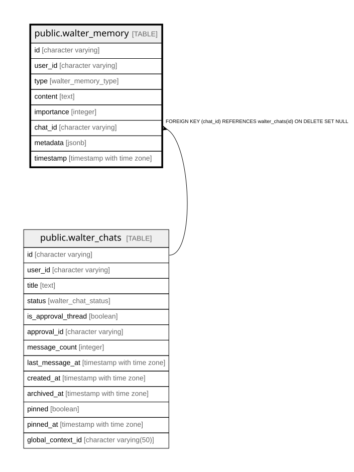

# public.walter_memory

## Columns

| Name | Type | Default | Nullable | Children | Parents | Comment |
| ---- | ---- | ------- | -------- | -------- | ------- | ------- |
| id | character varying | gen_random_uuid() | false |  |  |  |
| user_id | character varying |  | false |  |  |  |
| type | walter_memory_type |  | false |  |  |  |
| content | text |  | false |  |  |  |
| importance | integer | 3 | false |  |  |  |
| chat_id | character varying |  | true |  | [public.walter_chats](public.walter_chats.md) |  |
| metadata | jsonb |  | true |  |  |  |
| timestamp | timestamp with time zone | now() | true |  |  |  |

## Viewpoints

| Name | Definition |
| ---- | ---------- |
| [public schema](viewpoint-schema-public.md) | All mapped relations in public. |

## Constraints

| Name | Type | Definition |
| ---- | ---- | ---------- |
| walter_memory_chat_id_walter_chats_id_fk | FOREIGN KEY | FOREIGN KEY (chat_id) REFERENCES walter_chats(id) ON DELETE SET NULL |
| walter_memory_pkey | PRIMARY KEY | PRIMARY KEY (id) |

## Indexes

| Name | Definition |
| ---- | ---------- |
| walter_memory_importance_idx | CREATE INDEX walter_memory_importance_idx ON public.walter_memory USING btree (importance) |
| walter_memory_pkey | CREATE UNIQUE INDEX walter_memory_pkey ON public.walter_memory USING btree (id) |
| walter_memory_timestamp_idx | CREATE INDEX walter_memory_timestamp_idx ON public.walter_memory USING btree ("timestamp") |
| walter_memory_user_type_idx | CREATE INDEX walter_memory_user_type_idx ON public.walter_memory USING btree (user_id, type) |

## Relations

---

> Generated by [tbls](https://github.com/k1LoW/tbls)
