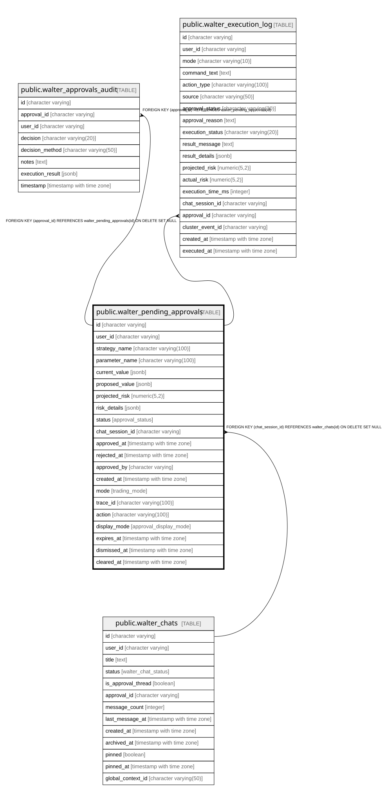

# public.walter_pending_approvals

## Columns

| Name | Type | Default | Nullable | Children | Parents | Comment |
| ---- | ---- | ------- | -------- | -------- | ------- | ------- |
| id | character varying | gen_random_uuid() | false | [public.walter_approvals_audit](public.walter_approvals_audit.md) [public.walter_execution_log](public.walter_execution_log.md) |  |  |
| user_id | character varying |  | false |  |  |  |
| strategy_name | character varying(100) |  | true |  |  |  |
| parameter_name | character varying(100) |  | false |  |  |  |
| current_value | jsonb |  | false |  |  |  |
| proposed_value | jsonb |  | false |  |  |  |
| projected_risk | numeric(5,2) |  | false |  |  |  |
| risk_details | jsonb |  | true |  |  |  |
| status | approval_status | 'pending'::approval_status | true |  |  |  |
| chat_session_id | character varying |  | true |  | [public.walter_chats](public.walter_chats.md) |  |
| approved_at | timestamp with time zone |  | true |  |  |  |
| rejected_at | timestamp with time zone |  | true |  |  |  |
| approved_by | character varying |  | true |  |  |  |
| created_at | timestamp with time zone | now() | true |  |  |  |
| mode | trading_mode |  | false |  |  |  |
| trace_id | character varying(100) |  | true |  |  |  |
| action | character varying(100) |  | true |  |  |  |
| display_mode | approval_display_mode | 'inline'::approval_display_mode | true |  |  |  |
| expires_at | timestamp with time zone |  | true |  |  |  |
| dismissed_at | timestamp with time zone |  | true |  |  |  |
| cleared_at | timestamp with time zone |  | true |  |  |  |

## Viewpoints

| Name | Definition |
| ---- | ---------- |
| [public schema](viewpoint-schema-public.md) | All mapped relations in public. |

## Constraints

| Name | Type | Definition |
| ---- | ---- | ---------- |
| walter_pending_approvals_chat_session_id_walter_chats_id_fk | FOREIGN KEY | FOREIGN KEY (chat_session_id) REFERENCES walter_chats(id) ON DELETE SET NULL |
| walter_pending_approvals_pkey | PRIMARY KEY | PRIMARY KEY (id) |
| walter_pending_approvals_trace_id_key | UNIQUE | UNIQUE (trace_id) |

## Indexes

| Name | Definition |
| ---- | ---------- |
| walter_pending_approvals_pkey | CREATE UNIQUE INDEX walter_pending_approvals_pkey ON public.walter_pending_approvals USING btree (id) |
| walter_pending_approvals_trace_id_key | CREATE UNIQUE INDEX walter_pending_approvals_trace_id_key ON public.walter_pending_approvals USING btree (trace_id) |

## Relations

---

> Generated by [tbls](https://github.com/k1LoW/tbls)
