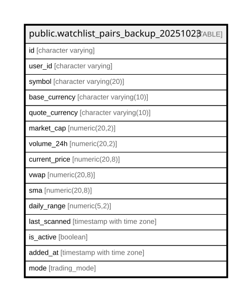

# public.watchlist_pairs_backup_20251023

## Columns

| Name | Type | Default | Nullable | Children | Parents | Comment |
| ---- | ---- | ------- | -------- | -------- | ------- | ------- |
| id | character varying | gen_random_uuid() | false |  |  |  |
| user_id | character varying |  | false |  |  |  |
| symbol | character varying(20) |  | false |  |  |  |
| base_currency | character varying(10) |  | false |  |  |  |
| quote_currency | character varying(10) |  | false |  |  |  |
| market_cap | numeric(20,2) |  | true |  |  |  |
| volume_24h | numeric(20,2) |  | true |  |  |  |
| current_price | numeric(20,8) |  | true |  |  |  |
| vwap | numeric(20,8) |  | true |  |  |  |
| sma | numeric(20,8) |  | true |  |  |  |
| daily_range | numeric(5,2) |  | true |  |  |  |
| last_scanned | timestamp with time zone |  | true |  |  |  |
| is_active | boolean | true | true |  |  |  |
| added_at | timestamp with time zone | now() | true |  |  |  |
| mode | trading_mode | 'paper'::trading_mode | false |  |  |  |

## Viewpoints

| Name | Definition |
| ---- | ---------- |
| [public schema](viewpoint-schema-public.md) | All mapped relations in public. |

## Constraints

| Name | Type | Definition |
| ---- | ---- | ---------- |
| watchlist_pairs_backup_20251023_pkey | PRIMARY KEY | PRIMARY KEY (id) |

## Indexes

| Name | Definition |
| ---- | ---------- |
| watchlist_pairs_backup_20251023_pkey | CREATE UNIQUE INDEX watchlist_pairs_backup_20251023_pkey ON public.watchlist_pairs_backup_20251023 USING btree (id) |
| watchlist_pairs_backup_20251023_user_id_mode_symbol_idx | CREATE UNIQUE INDEX watchlist_pairs_backup_20251023_user_id_mode_symbol_idx ON public.watchlist_pairs_backup_20251023 USING btree (user_id, mode, symbol) |

## Relations

---

> Generated by [tbls](https://github.com/k1LoW/tbls)
