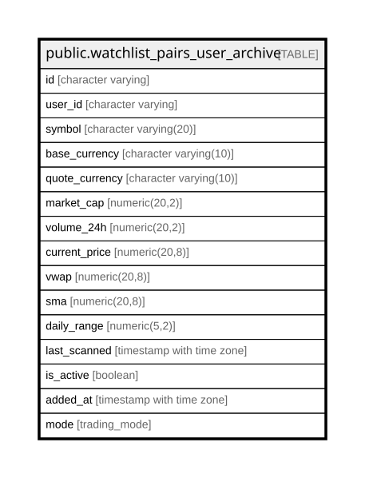

# public.watchlist_pairs_user_archive

## Columns

| Name | Type | Default | Nullable | Children | Parents | Comment |
| ---- | ---- | ------- | -------- | -------- | ------- | ------- |
| id | character varying |  | true |  |  |  |
| user_id | character varying |  | true |  |  |  |
| symbol | character varying(20) |  | true |  |  |  |
| base_currency | character varying(10) |  | true |  |  |  |
| quote_currency | character varying(10) |  | true |  |  |  |
| market_cap | numeric(20,2) |  | true |  |  |  |
| volume_24h | numeric(20,2) |  | true |  |  |  |
| current_price | numeric(20,8) |  | true |  |  |  |
| vwap | numeric(20,8) |  | true |  |  |  |
| sma | numeric(20,8) |  | true |  |  |  |
| daily_range | numeric(5,2) |  | true |  |  |  |
| last_scanned | timestamp with time zone |  | true |  |  |  |
| is_active | boolean |  | true |  |  |  |
| added_at | timestamp with time zone |  | true |  |  |  |
| mode | trading_mode |  | true |  |  |  |

## Viewpoints

| Name | Definition |
| ---- | ---------- |
| [public schema](viewpoint-schema-public.md) | All mapped relations in public. |

## Relations

---

> Generated by [tbls](https://github.com/k1LoW/tbls)
