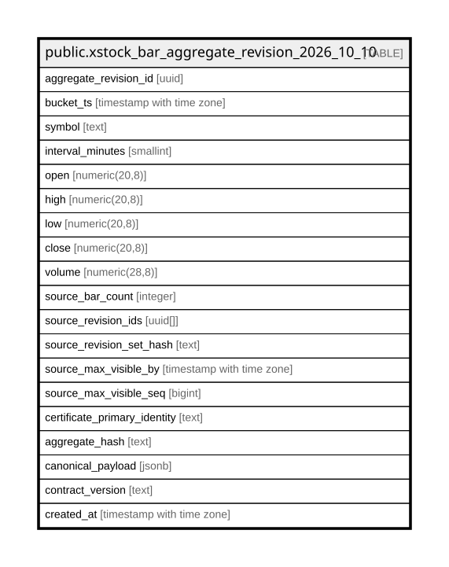

# public.xstock_bar_aggregate_revision_2026_10_10

## Columns

| Name | Type | Default | Nullable | Children | Parents | Comment |
| ---- | ---- | ------- | -------- | -------- | ------- | ------- |
| aggregate_revision_id | uuid | gen_random_uuid() | false |  |  |  |
| bucket_ts | timestamp with time zone |  | false |  |  |  |
| symbol | text |  | false |  |  |  |
| interval_minutes | smallint |  | false |  |  |  |
| open | numeric(20,8) |  | false |  |  |  |
| high | numeric(20,8) |  | false |  |  |  |
| low | numeric(20,8) |  | false |  |  |  |
| close | numeric(20,8) |  | false |  |  |  |
| volume | numeric(28,8) |  | false |  |  |  |
| source_bar_count | integer |  | false |  |  |  |
| source_revision_ids | uuid[] |  | false |  |  |  |
| source_revision_set_hash | text |  | false |  |  |  |
| source_max_visible_by | timestamp with time zone |  | false |  |  |  |
| source_max_visible_seq | bigint |  | false |  |  |  |
| certificate_primary_identity | text |  | false |  |  |  |
| aggregate_hash | text |  | false |  |  |  |
| canonical_payload | jsonb |  | false |  |  |  |
| contract_version | text |  | false |  |  |  |
| created_at | timestamp with time zone | clock_timestamp() | false |  |  |  |

## Viewpoints

| Name | Definition |
| ---- | ---------- |
| [public schema](viewpoint-schema-public.md) | All mapped relations in public. |

## Constraints

| Name | Type | Definition |
| ---- | ---- | ---------- |
| xstock_bar_aggregate_revisio_symbol_interval_minutes_buck_key10 | UNIQUE | UNIQUE (symbol, interval_minutes, bucket_ts, aggregate_hash) |
| xstock_bar_aggregate_revision_2026_10_10_pkey | PRIMARY KEY | PRIMARY KEY (aggregate_revision_id, bucket_ts) |
| xstock_bar_aggregate_revision_aggregate_hash_check | CHECK | CHECK (aggregate_hash ~ '^[0-9a-f]{64}$'::text) |
| xstock_bar_aggregate_revision_interval_minutes_check | CHECK | CHECK (interval_minutes = ANY (ARRAY[15, 60])) |
| xstock_bar_aggregate_revision_source_bar_count_check | CHECK | CHECK (source_bar_count > 0) |
| xstock_bar_aggregate_revision_source_revision_ids_check | CHECK | CHECK (cardinality(source_revision_ids) > 0) |
| xstock_bar_aggregate_revision_source_revision_set_hash_check | CHECK | CHECK (source_revision_set_hash ~ '^[0-9a-f]{64}$'::text) |

## Indexes

| Name | Definition |
| ---- | ---------- |
| xstock_bar_aggregate_revisio_symbol_interval_minutes_buck_key10 | CREATE UNIQUE INDEX xstock_bar_aggregate_revisio_symbol_interval_minutes_buck_key10 ON public.xstock_bar_aggregate_revision_2026_10_10 USING btree (symbol, interval_minutes, bucket_ts, aggregate_hash) |
| xstock_bar_aggregate_revision_2026_10_10_pkey | CREATE UNIQUE INDEX xstock_bar_aggregate_revision_2026_10_10_pkey ON public.xstock_bar_aggregate_revision_2026_10_10 USING btree (aggregate_revision_id, bucket_ts) |
| xstock_bar_aggregate_revision_202_source_revision_set_hash_idx9 | CREATE INDEX xstock_bar_aggregate_revision_202_source_revision_set_hash_idx9 ON public.xstock_bar_aggregate_revision_2026_10_10 USING btree (source_revision_set_hash) |
| xstock_bar_aggregate_revision_symbol_interval_minutes_buck_idx9 | CREATE INDEX xstock_bar_aggregate_revision_symbol_interval_minutes_buck_idx9 ON public.xstock_bar_aggregate_revision_2026_10_10 USING btree (symbol, interval_minutes, bucket_ts DESC, created_at DESC) |

## Relations

---

> Generated by [tbls](https://github.com/k1LoW/tbls)
