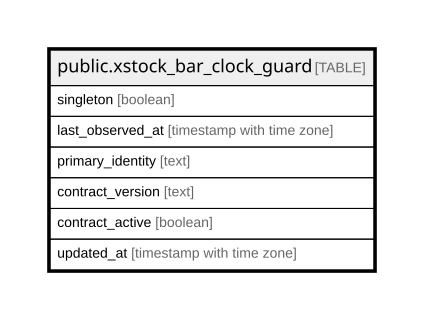

# public.xstock_bar_clock_guard

## Columns

| Name | Type | Default | Nullable | Children | Parents | Comment |
| ---- | ---- | ------- | -------- | -------- | ------- | ------- |
| singleton | boolean | true | false |  |  |  |
| last_observed_at | timestamp with time zone |  | false |  |  |  |
| primary_identity | text |  | false |  |  |  |
| contract_version | text |  | false |  |  |  |
| contract_active | boolean | false | false |  |  |  |
| updated_at | timestamp with time zone | clock_timestamp() | false |  |  |  |

## Viewpoints

| Name | Definition |
| ---- | ---------- |
| [public schema](viewpoint-schema-public.md) | All mapped relations in public. |

## Constraints

| Name | Type | Definition |
| ---- | ---- | ---------- |
| xstock_bar_clock_guard_pkey | PRIMARY KEY | PRIMARY KEY (singleton) |
| xstock_bar_clock_guard_singleton_check | CHECK | CHECK (singleton) |

## Indexes

| Name | Definition |
| ---- | ---------- |
| xstock_bar_clock_guard_pkey | CREATE UNIQUE INDEX xstock_bar_clock_guard_pkey ON public.xstock_bar_clock_guard USING btree (singleton) |

## Relations

---

> Generated by [tbls](https://github.com/k1LoW/tbls)
