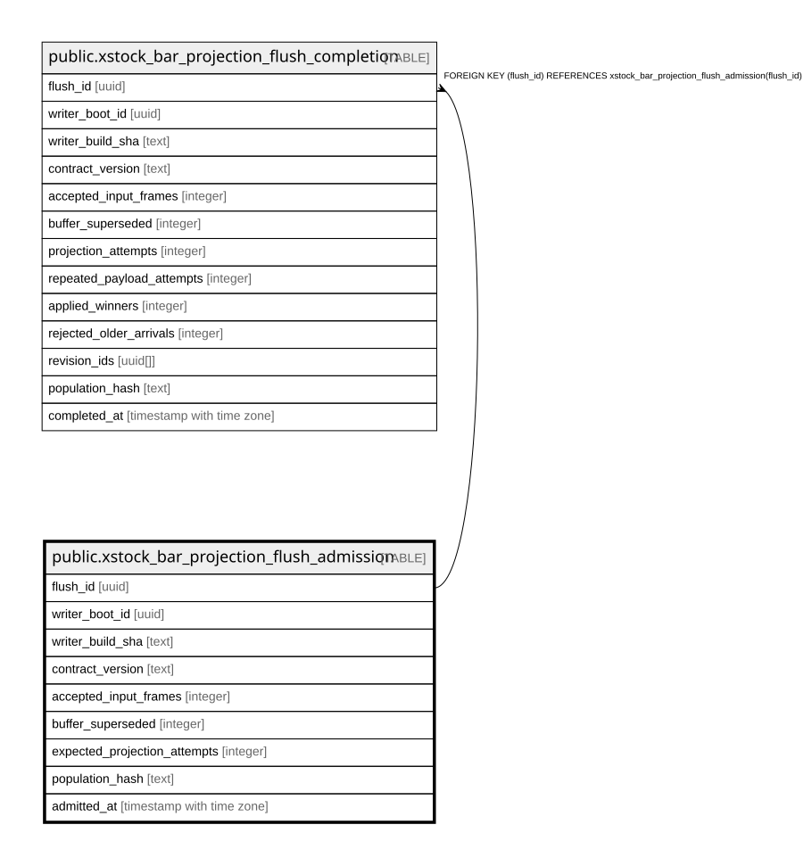

# public.xstock_bar_projection_flush_admission

## Description

Append-only xStock logical flush population admitted before projection.

## Columns

| Name | Type | Default | Nullable | Children | Parents | Comment |
| ---- | ---- | ------- | -------- | -------- | ------- | ------- |
| flush_id | uuid |  | false | [public.xstock_bar_projection_flush_completion](public.xstock_bar_projection_flush_completion.md) |  |  |
| writer_boot_id | uuid |  | false |  |  |  |
| writer_build_sha | text |  | false |  |  |  |
| contract_version | text |  | false |  |  |  |
| accepted_input_frames | integer |  | false |  |  |  |
| buffer_superseded | integer |  | false |  |  |  |
| expected_projection_attempts | integer |  | false |  |  |  |
| population_hash | text |  | false |  |  |  |
| admitted_at | timestamp with time zone | clock_timestamp() | false |  |  |  |

## Viewpoints

| Name | Definition |
| ---- | ---------- |
| [public schema](viewpoint-schema-public.md) | All mapped relations in public. |

## Constraints

| Name | Type | Definition |
| ---- | ---- | ---------- |
| xstock_bar_projection_flush__expected_projection_attempts_check | CHECK | CHECK (expected_projection_attempts > 0) |
| xstock_bar_projection_flush_admissi_accepted_input_frames_check | CHECK | CHECK (accepted_input_frames > 0) |
| xstock_bar_projection_flush_admission_check | CHECK | CHECK (buffer_superseded >= 0 AND buffer_superseded < accepted_input_frames) |
| xstock_bar_projection_flush_admission_check1 | CHECK | CHECK ((accepted_input_frames - buffer_superseded) = expected_projection_attempts) |
| xstock_bar_projection_flush_admission_pkey | PRIMARY KEY | PRIMARY KEY (flush_id) |
| xstock_bar_projection_flush_admission_population_hash_check | CHECK | CHECK (population_hash ~ '^[0-9a-f]{64}$'::text) |
| xstock_bar_projection_flush_admission_writer_build_sha_check | CHECK | CHECK (writer_build_sha <> ''::text) |

## Indexes

| Name | Definition |
| ---- | ---------- |
| idx_xstock_bar_projection_flush_admission_time | CREATE INDEX idx_xstock_bar_projection_flush_admission_time ON public.xstock_bar_projection_flush_admission USING btree (admitted_at, flush_id) |
| xstock_bar_projection_flush_admission_pkey | CREATE UNIQUE INDEX xstock_bar_projection_flush_admission_pkey ON public.xstock_bar_projection_flush_admission USING btree (flush_id) |

## Relations

---

> Generated by [tbls](https://github.com/k1LoW/tbls)
