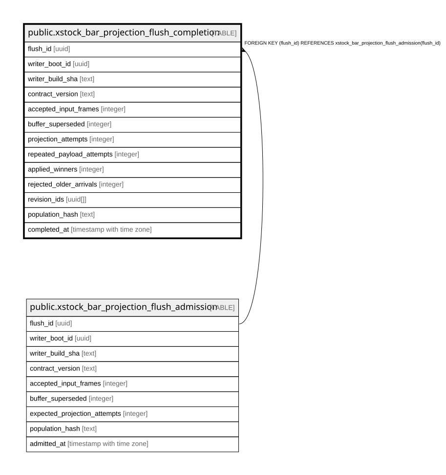

# public.xstock_bar_projection_flush_completion

## Description

Append-only xStock projection completion committed atomically with immutable revision events.

## Columns

| Name | Type | Default | Nullable | Children | Parents | Comment |
| ---- | ---- | ------- | -------- | -------- | ------- | ------- |
| flush_id | uuid |  | false |  | [public.xstock_bar_projection_flush_admission](public.xstock_bar_projection_flush_admission.md) |  |
| writer_boot_id | uuid |  | false |  |  |  |
| writer_build_sha | text |  | false |  |  |  |
| contract_version | text |  | false |  |  |  |
| accepted_input_frames | integer |  | false |  |  |  |
| buffer_superseded | integer |  | false |  |  |  |
| projection_attempts | integer |  | false |  |  |  |
| repeated_payload_attempts | integer |  | false |  |  |  |
| applied_winners | integer |  | false |  |  |  |
| rejected_older_arrivals | integer |  | false |  |  |  |
| revision_ids | uuid[] |  | false |  |  |  |
| population_hash | text |  | false |  |  |  |
| completed_at | timestamp with time zone | clock_timestamp() | false |  |  |  |

## Viewpoints

| Name | Definition |
| ---- | ---------- |
| [public schema](viewpoint-schema-public.md) | All mapped relations in public. |

## Constraints

| Name | Type | Definition |
| ---- | ---- | ---------- |
| xstock_bar_projection_flush_complet_accepted_input_frames_check | CHECK | CHECK (accepted_input_frames > 0) |
| xstock_bar_projection_flush_completio_projection_attempts_check | CHECK | CHECK (projection_attempts > 0) |
| xstock_bar_projection_flush_completion_check | CHECK | CHECK (buffer_superseded >= 0 AND buffer_superseded < accepted_input_frames) |
| xstock_bar_projection_flush_completion_check1 | CHECK | CHECK (repeated_payload_attempts >= 0 AND repeated_payload_attempts <= projection_attempts) |
| xstock_bar_projection_flush_completion_check2 | CHECK | CHECK (applied_winners >= 0 AND applied_winners <= projection_attempts) |
| xstock_bar_projection_flush_completion_check3 | CHECK | CHECK (rejected_older_arrivals >= 0 AND rejected_older_arrivals <= projection_attempts) |
| xstock_bar_projection_flush_completion_check4 | CHECK | CHECK (cardinality(revision_ids) = projection_attempts) |
| xstock_bar_projection_flush_completion_check5 | CHECK | CHECK ((accepted_input_frames - buffer_superseded) = projection_attempts) |
| xstock_bar_projection_flush_completion_check6 | CHECK | CHECK ((applied_winners + rejected_older_arrivals) = projection_attempts) |
| xstock_bar_projection_flush_completion_flush_id_fkey | FOREIGN KEY | FOREIGN KEY (flush_id) REFERENCES xstock_bar_projection_flush_admission(flush_id) |
| xstock_bar_projection_flush_completion_pkey | PRIMARY KEY | PRIMARY KEY (flush_id) |
| xstock_bar_projection_flush_completion_population_hash_check | CHECK | CHECK (population_hash ~ '^[0-9a-f]{64}$'::text) |
| xstock_bar_projection_flush_completion_writer_build_sha_check | CHECK | CHECK (writer_build_sha <> ''::text) |

## Indexes

| Name | Definition |
| ---- | ---------- |
| idx_xstock_bar_projection_flush_completion_time | CREATE INDEX idx_xstock_bar_projection_flush_completion_time ON public.xstock_bar_projection_flush_completion USING btree (completed_at, flush_id) |
| xstock_bar_projection_flush_completion_pkey | CREATE UNIQUE INDEX xstock_bar_projection_flush_completion_pkey ON public.xstock_bar_projection_flush_completion USING btree (flush_id) |

## Relations

---

> Generated by [tbls](https://github.com/k1LoW/tbls)
