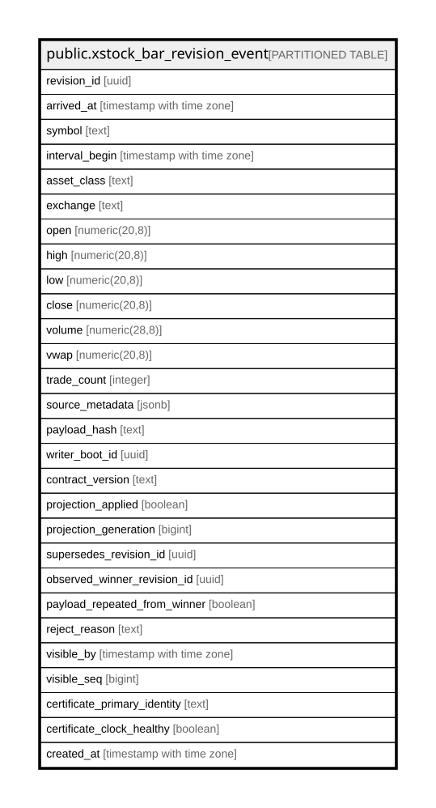

# public.xstock_bar_revision_event

## Description

B-XSTOCK-BAR-AVAILABILITY v1: append-only post-buffer projection attempts. interval_begin remains the Kraken label; visibility is a later primary observation.

## Columns

| Name | Type | Default | Nullable | Children | Parents | Comment |
| ---- | ---- | ------- | -------- | -------- | ------- | ------- |
| revision_id | uuid |  | false |  |  |  |
| arrived_at | timestamp with time zone |  | false |  |  |  |
| symbol | text |  | false |  |  |  |
| interval_begin | timestamp with time zone |  | false |  |  |  |
| asset_class | text |  | false |  |  |  |
| exchange | text |  | false |  |  |  |
| open | numeric(20,8) |  | false |  |  |  |
| high | numeric(20,8) |  | false |  |  |  |
| low | numeric(20,8) |  | false |  |  |  |
| close | numeric(20,8) |  | false |  |  |  |
| volume | numeric(28,8) |  | false |  |  |  |
| vwap | numeric(20,8) |  | true |  |  |  |
| trade_count | integer |  | true |  |  |  |
| source_metadata | jsonb | '{}'::jsonb | false |  |  |  |
| payload_hash | text |  | false |  |  |  |
| writer_boot_id | uuid |  | false |  |  |  |
| contract_version | text |  | false |  |  |  |
| projection_applied | boolean |  | false |  |  |  |
| projection_generation | bigint |  | true |  |  |  |
| supersedes_revision_id | uuid |  | true |  |  |  |
| observed_winner_revision_id | uuid |  | true |  |  |  |
| payload_repeated_from_winner | boolean |  | false |  |  |  |
| reject_reason | text |  | true |  |  |  |
| visible_by | timestamp with time zone |  | true |  |  | Conservative database wall-time upper bound from a later primary statement; causal order is visible_seq. Not venue publication or exact commit time. |
| visible_seq | bigint |  | true |  |  |  |
| certificate_primary_identity | text |  | true |  |  |  |
| certificate_clock_healthy | boolean |  | true |  |  |  |
| created_at | timestamp with time zone | clock_timestamp() | false |  |  |  |

## Viewpoints

| Name | Definition |
| ---- | ---------- |
| [public schema](viewpoint-schema-public.md) | All mapped relations in public. |

## Constraints

| Name | Type | Definition |
| ---- | ---- | ---------- |
| xstock_bar_revision_event_asset_class_check | CHECK | CHECK (asset_class = 'xstock_spot'::text) |
| xstock_bar_revision_event_check | CHECK | CHECK (projection_applied AND projection_generation IS NOT NULL AND reject_reason IS NULL OR NOT projection_applied AND projection_generation IS NULL AND reject_reason IS NOT NULL) |
| xstock_bar_revision_event_check1 | CHECK | CHECK (visible_by IS NULL AND visible_seq IS NULL AND certificate_primary_identity IS NULL AND certificate_clock_healthy IS NULL OR visible_by IS NOT NULL AND visible_seq IS NOT NULL AND certificate_primary_identity IS NOT NULL AND certificate_clock_healthy = true) |
| xstock_bar_revision_event_payload_hash_check | CHECK | CHECK (payload_hash ~ '^[0-9a-f]{64}$'::text) |
| xstock_bar_revision_event_pkey | PRIMARY KEY | PRIMARY KEY (revision_id, arrived_at) |

## Indexes

| Name | Definition |
| ---- | ---------- |
| idx_xstock_bar_revision_event_archive_cursor | CREATE INDEX idx_xstock_bar_revision_event_archive_cursor ON ONLY public.xstock_bar_revision_event USING btree (arrived_at, revision_id) |
| idx_xstock_bar_revision_event_id | CREATE INDEX idx_xstock_bar_revision_event_id ON ONLY public.xstock_bar_revision_event USING btree (revision_id) |
| idx_xstock_bar_revision_event_pending_certificate | CREATE INDEX idx_xstock_bar_revision_event_pending_certificate ON ONLY public.xstock_bar_revision_event USING btree (created_at, revision_id) WHERE (visible_by IS NULL) |
| idx_xstock_bar_revision_event_visibility | CREATE INDEX idx_xstock_bar_revision_event_visibility ON ONLY public.xstock_bar_revision_event USING btree (visible_seq) WHERE (visible_seq IS NOT NULL) |
| idx_xstock_bar_revision_event_winner | CREATE INDEX idx_xstock_bar_revision_event_winner ON ONLY public.xstock_bar_revision_event USING btree (symbol, interval_begin, projection_generation DESC) WHERE projection_applied |
| xstock_bar_revision_event_pkey | CREATE UNIQUE INDEX xstock_bar_revision_event_pkey ON ONLY public.xstock_bar_revision_event USING btree (revision_id, arrived_at) |

## Relations

---

> Generated by [tbls](https://github.com/k1LoW/tbls)
