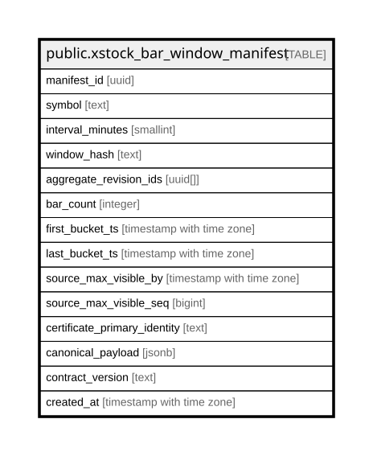

# public.xstock_bar_window_manifest

## Description

B-XSTOCK-BAR-AVAILABILITY v1: content-addressed ordered aggregate window, shared by decision provenance instead of repeating revision arrays.

## Columns

| Name | Type | Default | Nullable | Children | Parents | Comment |
| ---- | ---- | ------- | -------- | -------- | ------- | ------- |
| manifest_id | uuid | gen_random_uuid() | false |  |  |  |
| symbol | text |  | false |  |  |  |
| interval_minutes | smallint |  | false |  |  |  |
| window_hash | text |  | false |  |  |  |
| aggregate_revision_ids | uuid[] |  | false |  |  |  |
| bar_count | integer |  | false |  |  |  |
| first_bucket_ts | timestamp with time zone |  | false |  |  |  |
| last_bucket_ts | timestamp with time zone |  | false |  |  |  |
| source_max_visible_by | timestamp with time zone |  | false |  |  |  |
| source_max_visible_seq | bigint |  | false |  |  |  |
| certificate_primary_identity | text |  | false |  |  |  |
| canonical_payload | jsonb |  | false |  |  |  |
| contract_version | text |  | false |  |  |  |
| created_at | timestamp with time zone | clock_timestamp() | false |  |  |  |

## Viewpoints

| Name | Definition |
| ---- | ---------- |
| [public schema](viewpoint-schema-public.md) | All mapped relations in public. |

## Constraints

| Name | Type | Definition |
| ---- | ---- | ---------- |
| xstock_bar_window_manifest_aggregate_revision_ids_check | CHECK | CHECK (cardinality(aggregate_revision_ids) > 0) |
| xstock_bar_window_manifest_check | CHECK | CHECK (bar_count = cardinality(aggregate_revision_ids)) |
| xstock_bar_window_manifest_check1 | CHECK | CHECK (last_bucket_ts >= first_bucket_ts) |
| xstock_bar_window_manifest_interval_minutes_check | CHECK | CHECK (interval_minutes = ANY (ARRAY[15, 60])) |
| xstock_bar_window_manifest_pkey | PRIMARY KEY | PRIMARY KEY (manifest_id) |
| xstock_bar_window_manifest_symbol_interval_minutes_window_h_key | UNIQUE | UNIQUE (symbol, interval_minutes, window_hash) |
| xstock_bar_window_manifest_window_hash_check | CHECK | CHECK (window_hash ~ '^[0-9a-f]{64}$'::text) |

## Indexes

| Name | Definition |
| ---- | ---------- |
| idx_xstock_bar_window_manifest_created | CREATE INDEX idx_xstock_bar_window_manifest_created ON public.xstock_bar_window_manifest USING btree (created_at DESC) |
| xstock_bar_window_manifest_pkey | CREATE UNIQUE INDEX xstock_bar_window_manifest_pkey ON public.xstock_bar_window_manifest USING btree (manifest_id) |
| xstock_bar_window_manifest_symbol_interval_minutes_window_h_key | CREATE UNIQUE INDEX xstock_bar_window_manifest_symbol_interval_minutes_window_h_key ON public.xstock_bar_window_manifest USING btree (symbol, interval_minutes, window_hash) |

## Relations

---

> Generated by [tbls](https://github.com/k1LoW/tbls)
