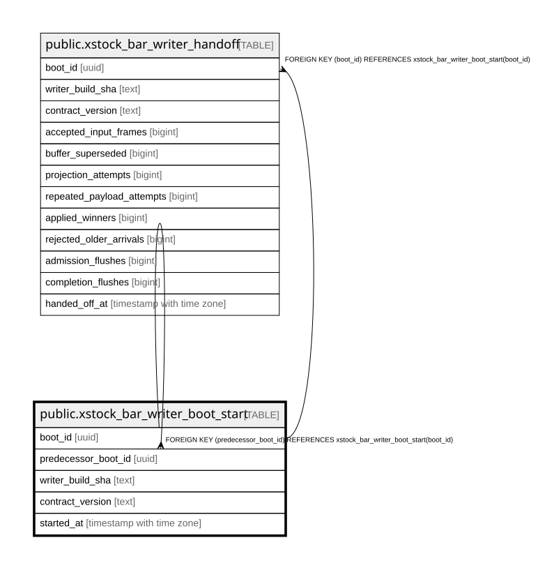

# public.xstock_bar_writer_boot_start

## Description

Append-only xStock writer boot chain used to prove deploy-safe observation continuity.

## Columns

| Name | Type | Default | Nullable | Children | Parents | Comment |
| ---- | ---- | ------- | -------- | -------- | ------- | ------- |
| boot_id | uuid |  | false | [public.xstock_bar_writer_boot_start](public.xstock_bar_writer_boot_start.md) [public.xstock_bar_writer_handoff](public.xstock_bar_writer_handoff.md) |  |  |
| predecessor_boot_id | uuid |  | true |  | [public.xstock_bar_writer_boot_start](public.xstock_bar_writer_boot_start.md) |  |
| writer_build_sha | text |  | false |  |  |  |
| contract_version | text |  | false |  |  |  |
| started_at | timestamp with time zone | clock_timestamp() | false |  |  |  |

## Viewpoints

| Name | Definition |
| ---- | ---------- |
| [public schema](viewpoint-schema-public.md) | All mapped relations in public. |

## Constraints

| Name | Type | Definition |
| ---- | ---- | ---------- |
| xstock_bar_writer_boot_start_check | CHECK | CHECK (predecessor_boot_id IS NULL OR predecessor_boot_id <> boot_id) |
| xstock_bar_writer_boot_start_pkey | PRIMARY KEY | PRIMARY KEY (boot_id) |
| xstock_bar_writer_boot_start_predecessor_boot_id_fkey | FOREIGN KEY | FOREIGN KEY (predecessor_boot_id) REFERENCES xstock_bar_writer_boot_start(boot_id) |
| xstock_bar_writer_boot_start_writer_build_sha_check | CHECK | CHECK (writer_build_sha ~ '^[0-9a-f]{40}$'::text) |

## Indexes

| Name | Definition |
| ---- | ---------- |
| idx_xstock_bar_writer_boot_start_time | CREATE INDEX idx_xstock_bar_writer_boot_start_time ON public.xstock_bar_writer_boot_start USING btree (started_at, boot_id) |
| uq_xstock_bar_writer_boot_predecessor | CREATE UNIQUE INDEX uq_xstock_bar_writer_boot_predecessor ON public.xstock_bar_writer_boot_start USING btree (predecessor_boot_id) WHERE (predecessor_boot_id IS NOT NULL) |
| xstock_bar_writer_boot_start_pkey | CREATE UNIQUE INDEX xstock_bar_writer_boot_start_pkey ON public.xstock_bar_writer_boot_start USING btree (boot_id) |

## Relations

---

> Generated by [tbls](https://github.com/k1LoW/tbls)
