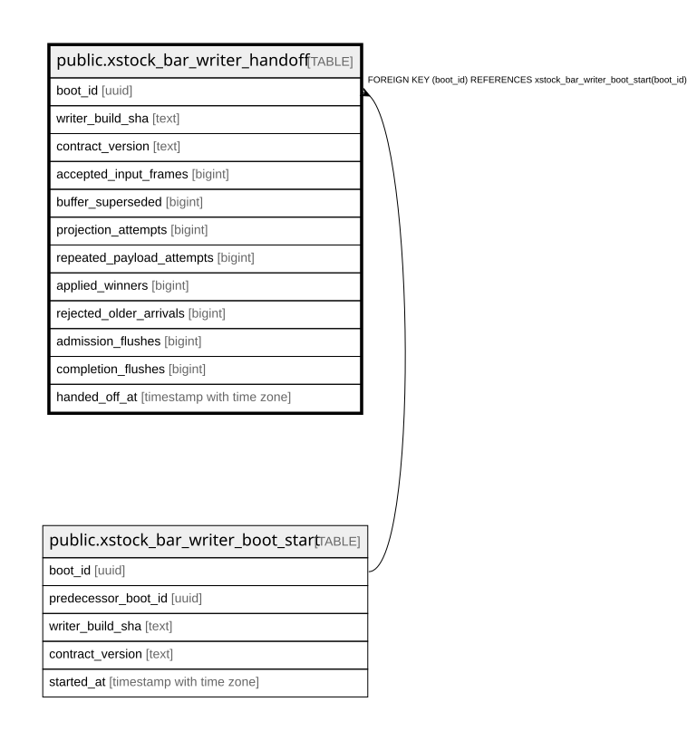

# public.xstock_bar_writer_handoff

## Description

Append-only clean-drain proof for one xStock writer boot before a deploy or restart.

## Columns

| Name | Type | Default | Nullable | Children | Parents | Comment |
| ---- | ---- | ------- | -------- | -------- | ------- | ------- |
| boot_id | uuid |  | false |  | [public.xstock_bar_writer_boot_start](public.xstock_bar_writer_boot_start.md) |  |
| writer_build_sha | text |  | false |  |  |  |
| contract_version | text |  | false |  |  |  |
| accepted_input_frames | bigint |  | false |  |  |  |
| buffer_superseded | bigint |  | false |  |  |  |
| projection_attempts | bigint |  | false |  |  |  |
| repeated_payload_attempts | bigint |  | false |  |  |  |
| applied_winners | bigint |  | false |  |  |  |
| rejected_older_arrivals | bigint |  | false |  |  |  |
| admission_flushes | bigint |  | false |  |  |  |
| completion_flushes | bigint |  | false |  |  |  |
| handed_off_at | timestamp with time zone | clock_timestamp() | false |  |  |  |

## Viewpoints

| Name | Definition |
| ---- | ---------- |
| [public schema](viewpoint-schema-public.md) | All mapped relations in public. |

## Constraints

| Name | Type | Definition |
| ---- | ---- | ---------- |
| xstock_bar_writer_handoff_accepted_input_frames_check | CHECK | CHECK (accepted_input_frames >= 0) |
| xstock_bar_writer_handoff_admission_flushes_check | CHECK | CHECK (admission_flushes >= 0) |
| xstock_bar_writer_handoff_boot_id_fkey | FOREIGN KEY | FOREIGN KEY (boot_id) REFERENCES xstock_bar_writer_boot_start(boot_id) |
| xstock_bar_writer_handoff_check | CHECK | CHECK (buffer_superseded >= 0 AND buffer_superseded <= accepted_input_frames) |
| xstock_bar_writer_handoff_check1 | CHECK | CHECK (repeated_payload_attempts >= 0 AND repeated_payload_attempts <= projection_attempts) |
| xstock_bar_writer_handoff_check2 | CHECK | CHECK (applied_winners >= 0 AND applied_winners <= projection_attempts) |
| xstock_bar_writer_handoff_check3 | CHECK | CHECK (rejected_older_arrivals >= 0 AND rejected_older_arrivals <= projection_attempts) |
| xstock_bar_writer_handoff_check4 | CHECK | CHECK ((accepted_input_frames - buffer_superseded) = projection_attempts) |
| xstock_bar_writer_handoff_check5 | CHECK | CHECK ((applied_winners + rejected_older_arrivals) = projection_attempts) |
| xstock_bar_writer_handoff_check6 | CHECK | CHECK (admission_flushes = completion_flushes) |
| xstock_bar_writer_handoff_completion_flushes_check | CHECK | CHECK (completion_flushes >= 0) |
| xstock_bar_writer_handoff_pkey | PRIMARY KEY | PRIMARY KEY (boot_id) |
| xstock_bar_writer_handoff_projection_attempts_check | CHECK | CHECK (projection_attempts >= 0) |
| xstock_bar_writer_handoff_writer_build_sha_check | CHECK | CHECK (writer_build_sha ~ '^[0-9a-f]{40}$'::text) |

## Indexes

| Name | Definition |
| ---- | ---------- |
| xstock_bar_writer_handoff_pkey | CREATE UNIQUE INDEX xstock_bar_writer_handoff_pkey ON public.xstock_bar_writer_handoff USING btree (boot_id) |

## Relations

---

> Generated by [tbls](https://github.com/k1LoW/tbls)
