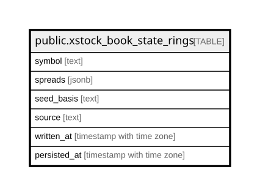

# public.xstock_book_state_rings

## Description

3n.q8 B-BOOK-STATE-RESTART-DURABLE (#1066): the xStock book-state guard's retained spread rings (SIM S25b), one row per symbol, so a restart does not make every first seed unjudged. Written and read only by book-state-ring-store.ts.

## Columns

| Name | Type | Default | Nullable | Children | Parents | Comment |
| ---- | ---- | ------- | -------- | -------- | ------- | ------- |
| symbol | text |  | false |  |  |  |
| spreads | jsonb |  | false |  |  |  |
| seed_basis | text |  | false |  |  |  |
| source | text |  | false |  |  |  |
| written_at | timestamp with time zone |  | false |  |  |  |
| persisted_at | timestamp with time zone | now() | false |  |  |  |

## Viewpoints

| Name | Definition |
| ---- | ---------- |
| [public schema](viewpoint-schema-public.md) | All mapped relations in public. |

## Constraints

| Name | Type | Definition |
| ---- | ---- | ---------- |
| xstock_book_state_rings_pkey | PRIMARY KEY | PRIMARY KEY (symbol) |
| xstock_book_state_rings_seed_basis_check | CHECK | CHECK (seed_basis = ANY (ARRAY['judged'::text, 'vacuous'::text])) |
| xstock_book_state_rings_source_check | CHECK | CHECK (source = ANY (ARRAY['live'::text, 'retained'::text])) |
| xstock_book_state_rings_spreads_is_array | CHECK | CHECK (jsonb_typeof(spreads) = 'array'::text) |

## Indexes

| Name | Definition |
| ---- | ---------- |
| xstock_book_state_rings_pkey | CREATE UNIQUE INDEX xstock_book_state_rings_pkey ON public.xstock_book_state_rings USING btree (symbol) |

## Relations

---

> Generated by [tbls](https://github.com/k1LoW/tbls)
