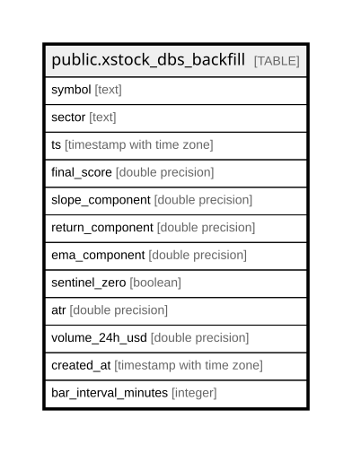

# public.xstock_dbs_backfill

## Columns

| Name | Type | Default | Nullable | Children | Parents | Comment |
| ---- | ---- | ------- | -------- | -------- | ------- | ------- |
| symbol | text |  | false |  |  |  |
| sector | text |  | false |  |  |  |
| ts | timestamp with time zone |  | false |  |  |  |
| final_score | double precision |  | false |  |  |  |
| slope_component | double precision |  | false |  |  |  |
| return_component | double precision |  | false |  |  |  |
| ema_component | double precision |  | false |  |  |  |
| sentinel_zero | boolean |  | false |  |  |  |
| atr | double precision |  | true |  |  |  |
| volume_24h_usd | double precision |  | true |  |  |  |
| created_at | timestamp with time zone | now() | true |  |  |  |
| bar_interval_minutes | integer | 60 | false |  |  | B.4 foundation (2026-06-03): bar substrate the DBS row was computed on. Existing rows = 60 (default). The supervised one-shot 15-min recompute archives the 60m rows to xstock_dbs_backfill_60m_archive, clears the live table, and inserts rows stamped 15 -\> live table is 15m-only thereafter. Mixed-substrate guard: consumers filter on this column (Langston Step-4 proof). |

## Viewpoints

| Name | Definition |
| ---- | ---------- |
| [public schema](viewpoint-schema-public.md) | All mapped relations in public. |

## Constraints

| Name | Type | Definition |
| ---- | ---- | ---------- |
| xstock_dbs_backfill_pkey | PRIMARY KEY | PRIMARY KEY (symbol, ts) |

## Indexes

| Name | Definition |
| ---- | ---------- |
| idx_xstock_dbs_backfill_sector_ts | CREATE INDEX idx_xstock_dbs_backfill_sector_ts ON public.xstock_dbs_backfill USING btree (sector, ts) |
| idx_xstock_dbs_backfill_ts | CREATE INDEX idx_xstock_dbs_backfill_ts ON public.xstock_dbs_backfill USING btree (ts) |
| xstock_dbs_backfill_pkey | CREATE UNIQUE INDEX xstock_dbs_backfill_pkey ON public.xstock_dbs_backfill USING btree (symbol, ts) |

## Relations

---

> Generated by [tbls](https://github.com/k1LoW/tbls)
