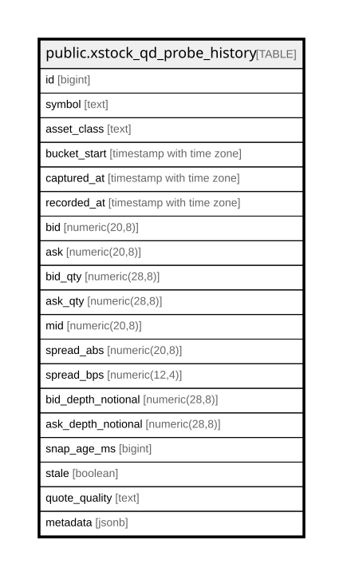

# public.xstock_qd_probe_history

## Columns

| Name | Type | Default | Nullable | Children | Parents | Comment |
| ---- | ---- | ------- | -------- | -------- | ------- | ------- |
| id | bigint | nextval('xstock_qd_probe_history_id_seq'::regclass) | false |  |  |  |
| symbol | text |  | false |  |  |  |
| asset_class | text | 'xstock_spot'::text | false |  |  |  |
| bucket_start | timestamp with time zone |  | false |  |  |  |
| captured_at | timestamp with time zone |  | true |  |  |  |
| recorded_at | timestamp with time zone | now() | false |  |  |  |
| bid | numeric(20,8) |  | true |  |  |  |
| ask | numeric(20,8) |  | true |  |  |  |
| bid_qty | numeric(28,8) |  | true |  |  |  |
| ask_qty | numeric(28,8) |  | true |  |  |  |
| mid | numeric(20,8) |  | true |  |  |  |
| spread_abs | numeric(20,8) |  | true |  |  |  |
| spread_bps | numeric(12,4) |  | true |  |  |  |
| bid_depth_notional | numeric(28,8) |  | true |  |  |  |
| ask_depth_notional | numeric(28,8) |  | true |  |  |  |
| snap_age_ms | bigint |  | true |  |  |  |
| stale | boolean | false | false |  |  |  |
| quote_quality | text | 'ok'::text | false |  |  |  |
| metadata | jsonb | '{"schema_version": 1}'::jsonb | false |  |  |  |

## Viewpoints

| Name | Definition |
| ---- | ---------- |
| [public schema](viewpoint-schema-public.md) | All mapped relations in public. |

## Constraints

| Name | Type | Definition |
| ---- | ---- | ---------- |
| xstock_qd_probe_history_pkey | PRIMARY KEY | PRIMARY KEY (id) |
| xstock_qd_probe_history_symbol_bucket_uniq | UNIQUE | UNIQUE (symbol, bucket_start) |

## Indexes

| Name | Definition |
| ---- | ---------- |
| xstock_qd_probe_history_bucket_idx | CREATE INDEX xstock_qd_probe_history_bucket_idx ON public.xstock_qd_probe_history USING btree (bucket_start) |
| xstock_qd_probe_history_pkey | CREATE UNIQUE INDEX xstock_qd_probe_history_pkey ON public.xstock_qd_probe_history USING btree (id) |
| xstock_qd_probe_history_symbol_bucket_uniq | CREATE UNIQUE INDEX xstock_qd_probe_history_symbol_bucket_uniq ON public.xstock_qd_probe_history USING btree (symbol, bucket_start) |

## Relations

---

> Generated by [tbls](https://github.com/k1LoW/tbls)
