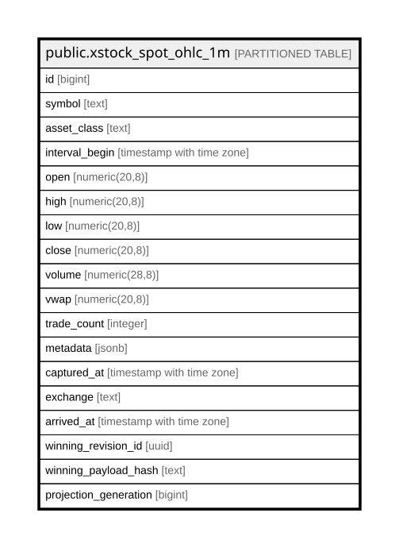

# public.xstock_spot_ohlc_1m

## Columns

| Name | Type | Default | Nullable | Children | Parents | Comment |
| ---- | ---- | ------- | -------- | -------- | ------- | ------- |
| id | bigint | nextval('equity_spot_ohlc_1m_id_seq'::regclass) | false |  |  |  |
| symbol | text |  | false |  |  |  |
| asset_class | text | 'xstock_spot'::text | false |  |  |  |
| interval_begin | timestamp with time zone |  | false |  |  |  |
| open | numeric(20,8) |  | false |  |  |  |
| high | numeric(20,8) |  | false |  |  |  |
| low | numeric(20,8) |  | false |  |  |  |
| close | numeric(20,8) |  | false |  |  |  |
| volume | numeric(28,8) |  | false |  |  |  |
| vwap | numeric(20,8) |  | true |  |  |  |
| trade_count | integer |  | true |  |  |  |
| metadata | jsonb | '{"schema_version": 1}'::jsonb | false |  |  |  |
| captured_at | timestamp with time zone | now() | false |  |  |  |
| exchange | text | 'kraken-equities'::text | false |  |  |  |
| arrived_at | timestamp with time zone |  | true |  |  | F-G-1 reopen P3 (#1031): when this process received the bar, stamped at bufferOhlcBar. The batch writer upsert never lets an earlier arrival overwrite a later one. NULL = written before 2026-09-29. |
| winning_revision_id | uuid |  | true |  |  | Current compact projection winner in xstock_bar_revision_event; NULL means pre-cutover/legacy. |
| winning_payload_hash | text |  | true |  |  |  |
| projection_generation | bigint | 0 | false |  |  |  |

## Viewpoints

| Name | Definition |
| ---- | ---------- |
| [public schema](viewpoint-schema-public.md) | All mapped relations in public. |

## Constraints

| Name | Type | Definition |
| ---- | ---- | ---------- |
| xstock_spot_ohlc_1m_pkey | PRIMARY KEY | PRIMARY KEY (interval_begin, symbol, id) |
| xstock_spot_ohlc_1m_symbol_interval_unique | UNIQUE | UNIQUE (symbol, interval_begin) |

## Indexes

| Name | Definition |
| ---- | ---------- |
| xstock_spot_ohlc_1m_pkey | CREATE UNIQUE INDEX xstock_spot_ohlc_1m_pkey ON ONLY public.xstock_spot_ohlc_1m USING btree (interval_begin, symbol, id) |
| xstock_spot_ohlc_1m_sym_time | CREATE INDEX xstock_spot_ohlc_1m_sym_time ON ONLY public.xstock_spot_ohlc_1m USING btree (symbol, interval_begin DESC) |
| xstock_spot_ohlc_1m_symbol_interval_unique | CREATE UNIQUE INDEX xstock_spot_ohlc_1m_symbol_interval_unique ON ONLY public.xstock_spot_ohlc_1m USING btree (symbol, interval_begin) |

## Relations

---

> Generated by [tbls](https://github.com/k1LoW/tbls)
