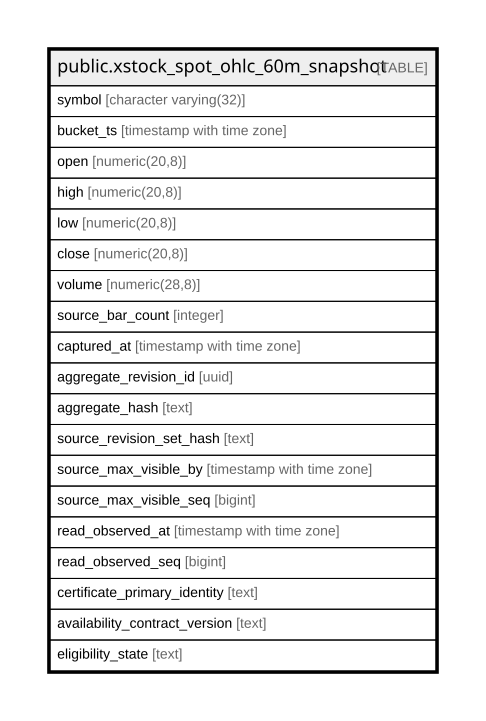

# public.xstock_spot_ohlc_60m_snapshot

## Description

B-NEW-34b (2026-05-18): Pre-aggregated 60-min OHLC buckets per xStock symbol. Cache reads on cold-start to satisfy min_ohlc_history_bars floor without live DISTINCT ON aggregation over xstock_spot_ohlc_1m duplicate rows. Refreshed by one-off pre-warm script + cache write-back-on-miss + (future B-NEW-36) weekly Fri-night/Sun-night session-lifecycle pre-warm.

## Columns

| Name | Type | Default | Nullable | Children | Parents | Comment |
| ---- | ---- | ------- | -------- | -------- | ------- | ------- |
| symbol | character varying(32) |  | false |  |  |  |
| bucket_ts | timestamp with time zone |  | false |  |  |  |
| open | numeric(20,8) |  | false |  |  |  |
| high | numeric(20,8) |  | false |  |  |  |
| low | numeric(20,8) |  | false |  |  |  |
| close | numeric(20,8) |  | false |  |  |  |
| volume | numeric(28,8) | 0 | false |  |  |  |
| source_bar_count | integer | 0 | false |  |  | Number of distinct 1-min source rows aggregated into this bucket (post-DISTINCT-ON dedup). Forensic: surfaces underfilled buckets without re-querying xstock_spot_ohlc_1m. |
| captured_at | timestamp with time zone | now() | false |  |  | When this snapshot row was last refreshed. Pre-warm script writes NOW(); cache write-back path updates on every miss. Use to detect stale rows in operations. |
| aggregate_revision_id | uuid |  | true |  |  |  |
| aggregate_hash | text |  | true |  |  |  |
| source_revision_set_hash | text |  | true |  |  |  |
| source_max_visible_by | timestamp with time zone |  | true |  |  |  |
| source_max_visible_seq | bigint |  | true |  |  |  |
| read_observed_at | timestamp with time zone |  | true |  |  | Original primary read observation for the exact aggregate revision; snapshot refresh time is not availability. |
| read_observed_seq | bigint |  | true |  |  |  |
| certificate_primary_identity | text |  | true |  |  |  |
| availability_contract_version | text |  | true |  |  |  |
| eligibility_state | text |  | true |  |  |  |

## Viewpoints

| Name | Definition |
| ---- | ---------- |
| [public schema](viewpoint-schema-public.md) | All mapped relations in public. |

## Constraints

| Name | Type | Definition |
| ---- | ---- | ---------- |
| xstock_spot_ohlc_60m_snapshot_availability_shape | CHECK | CHECK (aggregate_revision_id IS NULL AND aggregate_hash IS NULL AND source_revision_set_hash IS NULL AND source_max_visible_by IS NULL AND source_max_visible_seq IS NULL AND read_observed_at IS NULL AND read_observed_seq IS NULL AND certificate_primary_identity IS NULL AND availability_contract_version IS NULL AND eligibility_state IS NULL OR aggregate_revision_id IS NOT NULL AND aggregate_hash IS NOT NULL AND source_revision_set_hash IS NOT NULL AND source_max_visible_by IS NOT NULL AND source_max_visible_seq IS NOT NULL AND read_observed_at IS NOT NULL AND read_observed_seq IS NOT NULL AND certificate_primary_identity IS NOT NULL AND availability_contract_version = 'xstock-bar-availability/v1'::text AND eligibility_state = 'eligible_certified'::text) NOT VALID |
| xstock_spot_ohlc_60m_snapshot_pkey | PRIMARY KEY | PRIMARY KEY (symbol, bucket_ts) |

## Indexes

| Name | Definition |
| ---- | ---------- |
| idx_xstock_spot_ohlc_60m_snapshot_symbol_ts_desc | CREATE INDEX idx_xstock_spot_ohlc_60m_snapshot_symbol_ts_desc ON public.xstock_spot_ohlc_60m_snapshot USING btree (symbol, bucket_ts DESC) |
| xstock_spot_ohlc_60m_snapshot_pkey | CREATE UNIQUE INDEX xstock_spot_ohlc_60m_snapshot_pkey ON public.xstock_spot_ohlc_60m_snapshot USING btree (symbol, bucket_ts) |

## Relations

---

> Generated by [tbls](https://github.com/k1LoW/tbls)
