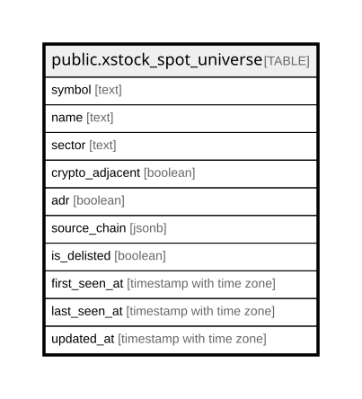

# public.xstock_spot_universe

## Columns

| Name | Type | Default | Nullable | Children | Parents | Comment |
| ---- | ---- | ------- | -------- | -------- | ------- | ------- |
| symbol | text |  | false |  |  |  |
| name | text |  | true |  |  |  |
| sector | text |  | false |  |  |  |
| crypto_adjacent | boolean | false | false |  |  |  |
| adr | boolean | false | false |  |  |  |
| source_chain | jsonb |  | false |  |  |  |
| is_delisted | boolean | false | false |  |  |  |
| first_seen_at | timestamp with time zone | now() | false |  |  |  |
| last_seen_at | timestamp with time zone | now() | false |  |  |  |
| updated_at | timestamp with time zone | now() | false |  |  |  |

## Viewpoints

| Name | Definition |
| ---- | ---------- |
| [public schema](viewpoint-schema-public.md) | All mapped relations in public. |

## Constraints

| Name | Type | Definition |
| ---- | ---- | ---------- |
| xstock_spot_universe_pkey | PRIMARY KEY | PRIMARY KEY (symbol) |
| xstock_spot_universe_sector_chk | CHECK | CHECK (sector = ANY (ARRAY['XLK'::text, 'XLV'::text, 'XLF'::text, 'XLC'::text, 'XLY'::text, 'XLP'::text, 'XLE'::text, 'XLI'::text, 'XLRE'::text, 'XLU'::text, 'XLB'::text, 'BROAD_ETF'::text, 'INDEX_PROXY'::text, 'INTL_ETF'::text, 'UNCATEGORIZED'::text])) |

## Indexes

| Name | Definition |
| ---- | ---------- |
| idx_xstock_spot_universe_is_delisted | CREATE INDEX idx_xstock_spot_universe_is_delisted ON public.xstock_spot_universe USING btree (is_delisted) |
| idx_xstock_spot_universe_last_seen | CREATE INDEX idx_xstock_spot_universe_last_seen ON public.xstock_spot_universe USING btree (last_seen_at) |
| idx_xstock_spot_universe_sector | CREATE INDEX idx_xstock_spot_universe_sector ON public.xstock_spot_universe USING btree (sector) |
| xstock_spot_universe_pkey | CREATE UNIQUE INDEX xstock_spot_universe_pkey ON public.xstock_spot_universe USING btree (symbol) |

## Relations

---

> Generated by [tbls](https://github.com/k1LoW/tbls)
