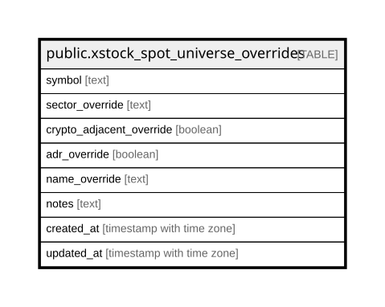

# public.xstock_spot_universe_overrides

## Columns

| Name | Type | Default | Nullable | Children | Parents | Comment |
| ---- | ---- | ------- | -------- | -------- | ------- | ------- |
| symbol | text |  | false |  |  |  |
| sector_override | text |  | true |  |  |  |
| crypto_adjacent_override | boolean |  | true |  |  |  |
| adr_override | boolean |  | true |  |  |  |
| name_override | text |  | true |  |  |  |
| notes | text |  | true |  |  |  |
| created_at | timestamp with time zone | now() | false |  |  |  |
| updated_at | timestamp with time zone | now() | false |  |  |  |

## Viewpoints

| Name | Definition |
| ---- | ---------- |
| [public schema](viewpoint-schema-public.md) | All mapped relations in public. |

## Constraints

| Name | Type | Definition |
| ---- | ---- | ---------- |
| xstock_spot_universe_overrides_pkey | PRIMARY KEY | PRIMARY KEY (symbol) |
| xstock_spot_universe_overrides_sector_chk | CHECK | CHECK (sector_override IS NULL OR (sector_override = ANY (ARRAY['XLK'::text, 'XLV'::text, 'XLF'::text, 'XLC'::text, 'XLY'::text, 'XLP'::text, 'XLE'::text, 'XLI'::text, 'XLRE'::text, 'XLU'::text, 'XLB'::text, 'BROAD_ETF'::text, 'INDEX_PROXY'::text, 'INTL_ETF'::text, 'UNCATEGORIZED'::text]))) |

## Indexes

| Name | Definition |
| ---- | ---------- |
| xstock_spot_universe_overrides_pkey | CREATE UNIQUE INDEX xstock_spot_universe_overrides_pkey ON public.xstock_spot_universe_overrides USING btree (symbol) |

## Relations

---

> Generated by [tbls](https://github.com/k1LoW/tbls)
