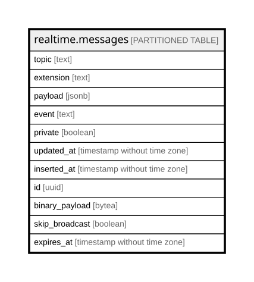

# realtime.messages

## Columns

| Name | Type | Default | Nullable | Children | Parents | Comment |
| ---- | ---- | ------- | -------- | -------- | ------- | ------- |
| topic | text |  | false |  |  |  |
| extension | text |  | false |  |  |  |
| payload | jsonb |  | true |  |  |  |
| event | text |  | true |  |  |  |
| private | boolean | false | true |  |  |  |
| updated_at | timestamp without time zone | timezone('utc'::text, clock_timestamp()) | false |  |  |  |
| inserted_at | timestamp without time zone | timezone('utc'::text, clock_timestamp()) | false |  |  |  |
| id | uuid | gen_random_uuid() | false |  |  |  |
| binary_payload | bytea |  | true |  |  |  |
| skip_broadcast | boolean | false | false |  |  |  |
| expires_at | timestamp without time zone |  | true |  |  |  |

## Viewpoints

| Name | Definition |
| ---- | ---------- |
| [realtime schema](viewpoint-schema-realtime.md) | All mapped relations in realtime. |

## Constraints

| Name | Type | Definition |
| ---- | ---- | ---------- |
| messages_payload_exclusive | CHECK | CHECK (payload IS NULL OR binary_payload IS NULL) NOT VALID |
| messages_pkey | PRIMARY KEY | PRIMARY KEY (id, inserted_at) |

## Indexes

| Name | Definition |
| ---- | ---------- |
| messages_pkey | CREATE UNIQUE INDEX messages_pkey ON ONLY realtime.messages USING btree (id, inserted_at) |
| messages_replay_index | CREATE INDEX messages_replay_index ON ONLY realtime.messages USING btree (topic, inserted_at DESC, COALESCE(expires_at, 'infinity'::timestamp without time zone)) WHERE ((extension = 'broadcast'::text) AND (private = true)) |

## Relations

---

> Generated by [tbls](https://github.com/k1LoW/tbls)
