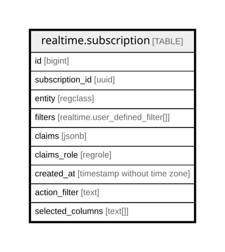

# realtime.subscription

## Columns

| Name | Type | Default | Nullable | Extra Definition | Children | Parents | Comment |
| ---- | ---- | ------- | -------- | ---------------- | -------- | ------- | ------- |
| id | bigint |  | false | GENERATED ALWAYS AS IDENTITY |  |  |  |
| subscription_id | uuid |  | false |  |  |  |  |
| entity | regclass |  | false |  |  |  |  |
| filters | realtime.user_defined_filter[] | '{}'::realtime.user_defined_filter[] | false |  |  |  |  |
| claims | jsonb |  | false |  |  |  |  |
| claims_role | regrole | realtime.to_regrole((claims -\>\> 'role'::text)) | false | GENERATED ALWAYS AS STORED |  |  |  |
| created_at | timestamp without time zone | timezone('utc'::text, now()) | false |  |  |  |  |
| action_filter | text | '*'::text | true |  |  |  |  |
| selected_columns | text[] |  | true |  |  |  |  |

## Viewpoints

| Name | Definition |
| ---- | ---------- |
| [realtime schema](viewpoint-schema-realtime.md) | All mapped relations in realtime. |

## Constraints

| Name | Type | Definition |
| ---- | ---- | ---------- |
| pk_subscription | PRIMARY KEY | PRIMARY KEY (id) |
| subscription_action_filter_check | CHECK | CHECK (action_filter = ANY (ARRAY['*'::text, 'INSERT'::text, 'UPDATE'::text, 'DELETE'::text])) |

## Indexes

| Name | Definition |
| ---- | ---------- |
| ix_realtime_subscription_entity | CREATE INDEX ix_realtime_subscription_entity ON realtime.subscription USING btree (entity) |
| pk_subscription | CREATE UNIQUE INDEX pk_subscription ON realtime.subscription USING btree (id) |
| subscription_subscription_id_entity_filters_hash_key | CREATE UNIQUE INDEX subscription_subscription_id_entity_filters_hash_key ON realtime.subscription USING btree (subscription_id, entity, realtime.filters_hash(filters), action_filter, COALESCE(selected_columns, '{}'::text[])) |

## Relations

---

> Generated by [tbls](https://github.com/k1LoW/tbls)
