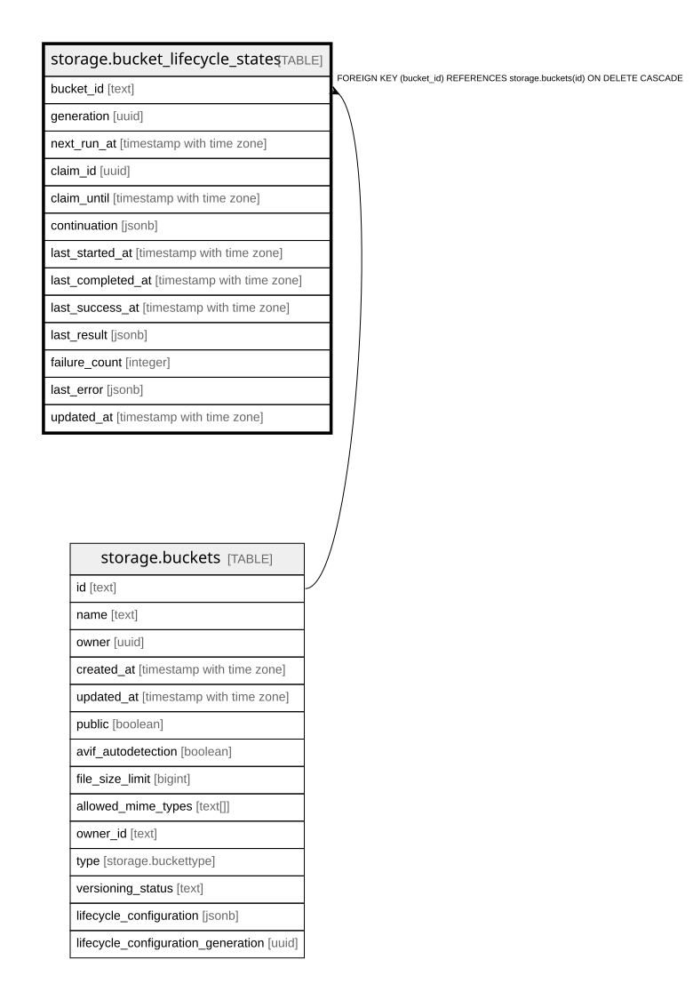

# storage.bucket_lifecycle_states

## Columns

| Name | Type | Default | Nullable | Children | Parents | Comment |
| ---- | ---- | ------- | -------- | -------- | ------- | ------- |
| bucket_id | text |  | false |  | [storage.buckets](storage.buckets.md) |  |
| generation | uuid |  | true |  |  |  |
| next_run_at | timestamp with time zone |  | true |  |  |  |
| claim_id | uuid |  | true |  |  |  |
| claim_until | timestamp with time zone |  | true |  |  |  |
| continuation | jsonb |  | true |  |  |  |
| last_started_at | timestamp with time zone |  | true |  |  |  |
| last_completed_at | timestamp with time zone |  | true |  |  |  |
| last_success_at | timestamp with time zone |  | true |  |  |  |
| last_result | jsonb |  | true |  |  |  |
| failure_count | integer | 0 | false |  |  |  |
| last_error | jsonb |  | true |  |  |  |
| updated_at | timestamp with time zone | now() | false |  |  |  |

## Viewpoints

| Name | Definition |
| ---- | ---------- |
| [storage schema](viewpoint-schema-storage.md) | All mapped relations in storage. |

## Constraints

| Name | Type | Definition |
| ---- | ---- | ---------- |
| bucket_lifecycle_continuation_object_check | CHECK | CHECK (continuation IS NULL OR jsonb_typeof(continuation) = 'object'::text) |
| bucket_lifecycle_failure_count_check | CHECK | CHECK (failure_count >= 0) |
| bucket_lifecycle_last_result_object_check | CHECK | CHECK (last_result IS NULL OR jsonb_typeof(last_result) = 'object'::text) |
| bucket_lifecycle_recovery_due_check | CHECK | CHECK (next_run_at IS NOT NULL OR NOT jsonb_path_exists(COALESCE(continuation, '{}'::jsonb), '$."batch"."inFlight"'::jsonpath)) |
| bucket_lifecycle_states_bucket_id_fkey | FOREIGN KEY | FOREIGN KEY (bucket_id) REFERENCES storage.buckets(id) ON DELETE CASCADE |
| bucket_lifecycle_states_pkey | PRIMARY KEY | PRIMARY KEY (bucket_id) |

## Indexes

| Name | Definition |
| ---- | ---------- |
| bucket_lifecycle_states_due_idx | CREATE INDEX bucket_lifecycle_states_due_idx ON storage.bucket_lifecycle_states USING btree (next_run_at, bucket_id) WHERE (next_run_at IS NOT NULL) |
| bucket_lifecycle_states_pkey | CREATE UNIQUE INDEX bucket_lifecycle_states_pkey ON storage.bucket_lifecycle_states USING btree (bucket_id) |

## Relations

---

> Generated by [tbls](https://github.com/k1LoW/tbls)
