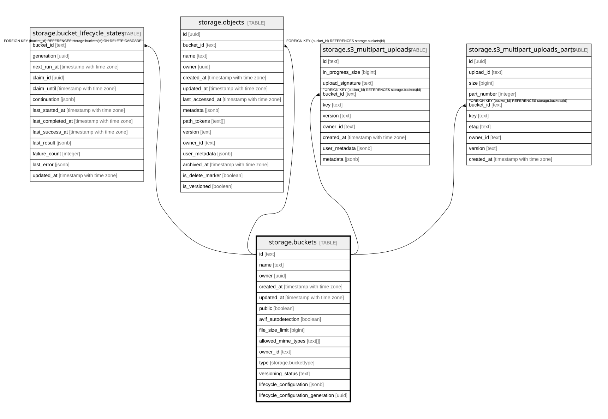

# storage.buckets

## Columns

| Name | Type | Default | Nullable | Children | Parents | Comment |
| ---- | ---- | ------- | -------- | -------- | ------- | ------- |
| id | text |  | false | [storage.bucket_lifecycle_states](storage.bucket_lifecycle_states.md) [storage.objects](storage.objects.md) [storage.s3_multipart_uploads](storage.s3_multipart_uploads.md) [storage.s3_multipart_uploads_parts](storage.s3_multipart_uploads_parts.md) |  |  |
| name | text |  | false |  |  |  |
| owner | uuid |  | true |  |  | Field is deprecated, use owner_id instead |
| created_at | timestamp with time zone | now() | true |  |  |  |
| updated_at | timestamp with time zone | now() | true |  |  |  |
| public | boolean | false | true |  |  |  |
| avif_autodetection | boolean | false | true |  |  |  |
| file_size_limit | bigint |  | true |  |  |  |
| allowed_mime_types | text[] |  | true |  |  |  |
| owner_id | text |  | true |  |  |  |
| type | storage.buckettype | 'STANDARD'::storage.buckettype | false |  |  |  |
| versioning_status | text | 'DISABLED'::text | false |  |  |  |
| lifecycle_configuration | jsonb |  | true |  |  |  |
| lifecycle_configuration_generation | uuid |  | true |  |  |  |

## Viewpoints

| Name | Definition |
| ---- | ---------- |
| [storage schema](viewpoint-schema-storage.md) | All mapped relations in storage. |

## Constraints

| Name | Type | Definition |
| ---- | ---- | ---------- |
| buckets_lifecycle_configuration_pair_check | CHECK | CHECK ((lifecycle_configuration IS NULL) = (lifecycle_configuration_generation IS NULL)) |
| buckets_lifecycle_configuration_shape_check | CHECK | CHECK (lifecycle_configuration IS NULL OR jsonb_typeof(lifecycle_configuration) = 'object'::text AND lifecycle_configuration ? 'rules'::text AND CASE     WHEN jsonb_typeof(lifecycle_configuration -> 'rules'::text) = 'array'::text THEN jsonb_array_length(lifecycle_configuration -> 'rules'::text) >= 1 AND jsonb_array_length(lifecycle_configuration -> 'rules'::text) <= 1000     ELSE false END) |
| buckets_lifecycle_configuration_standard_only_check | CHECK | CHECK (type = 'STANDARD'::storage.buckettype OR lifecycle_configuration IS NULL AND lifecycle_configuration_generation IS NULL) |
| buckets_pkey | PRIMARY KEY | PRIMARY KEY (id) |
| buckets_versioning_standard_only_check | CHECK | CHECK (type = 'STANDARD'::storage.buckettype OR versioning_status = 'DISABLED'::text) |
| buckets_versioning_status_check | CHECK | CHECK (versioning_status = ANY (ARRAY['DISABLED'::text, 'ENABLED'::text, 'SUSPENDED'::text])) |

## Indexes

| Name | Definition |
| ---- | ---------- |
| bname | CREATE UNIQUE INDEX bname ON storage.buckets USING btree (name) |
| buckets_pkey | CREATE UNIQUE INDEX buckets_pkey ON storage.buckets USING btree (id) |

## Relations

---

> Generated by [tbls](https://github.com/k1LoW/tbls)
