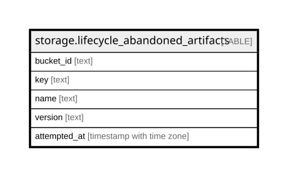

# storage.lifecycle_abandoned_artifacts

## Columns

| Name | Type | Default | Nullable | Children | Parents | Comment |
| ---- | ---- | ------- | -------- | -------- | ------- | ------- |
| bucket_id | text |  | false |  |  |  |
| key | text |  | false |  |  |  |
| name | text |  | false |  |  |  |
| version | text |  | true |  |  |  |
| attempted_at | timestamp with time zone | now() | false |  |  |  |

## Viewpoints

| Name | Definition |
| ---- | ---------- |
| [storage schema](viewpoint-schema-storage.md) | All mapped relations in storage. |

## Constraints

| Name | Type | Definition |
| ---- | ---- | ---------- |
| lifecycle_abandoned_artifacts_pkey | PRIMARY KEY | PRIMARY KEY (bucket_id, key) |

## Indexes

| Name | Definition |
| ---- | ---------- |
| lifecycle_abandoned_artifacts_attempted_at_idx | CREATE INDEX lifecycle_abandoned_artifacts_attempted_at_idx ON storage.lifecycle_abandoned_artifacts USING btree (attempted_at) |
| lifecycle_abandoned_artifacts_pkey | CREATE UNIQUE INDEX lifecycle_abandoned_artifacts_pkey ON storage.lifecycle_abandoned_artifacts USING btree (bucket_id, key) |

## Relations

---

> Generated by [tbls](https://github.com/k1LoW/tbls)
