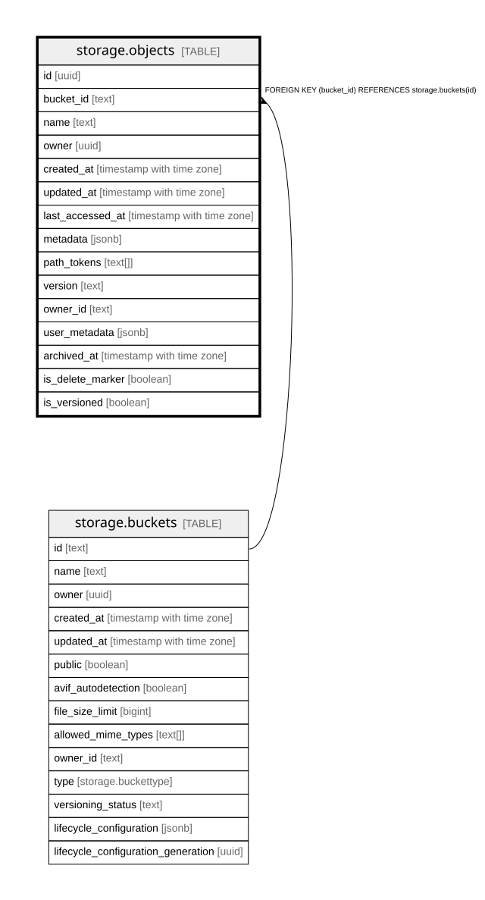

# storage.objects

## Columns

| Name | Type | Default | Nullable | Extra Definition | Children | Parents | Comment |
| ---- | ---- | ------- | -------- | ---------------- | -------- | ------- | ------- |
| id | uuid | gen_random_uuid() | false |  |  |  |  |
| bucket_id | text |  | true |  |  | [storage.buckets](storage.buckets.md) |  |
| name | text |  | true |  |  |  |  |
| owner | uuid |  | true |  |  |  | Field is deprecated, use owner_id instead |
| created_at | timestamp with time zone | now() | true |  |  |  |  |
| updated_at | timestamp with time zone | now() | true |  |  |  |  |
| last_accessed_at | timestamp with time zone | now() | true |  |  |  |  |
| metadata | jsonb |  | true |  |  |  |  |
| path_tokens | text[] | string_to_array(name, '/'::text) | true | GENERATED ALWAYS AS STORED |  |  |  |
| version | text |  | true |  |  |  |  |
| owner_id | text |  | true |  |  |  |  |
| user_metadata | jsonb |  | true |  |  |  |  |
| archived_at | timestamp with time zone |  | true |  |  |  |  |
| is_delete_marker | boolean | false | false |  |  |  |  |
| is_versioned | boolean | false | false |  |  |  |  |

## Viewpoints

| Name | Definition |
| ---- | ---------- |
| [storage schema](viewpoint-schema-storage.md) | All mapped relations in storage. |

## Constraints

| Name | Type | Definition |
| ---- | ---- | ---------- |
| objects_bucketId_fkey | FOREIGN KEY | FOREIGN KEY (bucket_id) REFERENCES storage.buckets(id) |
| objects_pkey | PRIMARY KEY | PRIMARY KEY (id) |

## Indexes

| Name | Definition |
| ---- | ---------- |
| idx_objects_bucket_id_name | CREATE INDEX idx_objects_bucket_id_name ON storage.objects USING btree (bucket_id, name COLLATE "C") |
| idx_objects_bucket_id_name_lower | CREATE INDEX idx_objects_bucket_id_name_lower ON storage.objects USING btree (bucket_id, lower(name) COLLATE "C") |
| idx_objects_current_version | CREATE UNIQUE INDEX idx_objects_current_version ON storage.objects USING btree (bucket_id, name COLLATE "C") WHERE (archived_at IS NULL) |
| idx_objects_delete_markers | CREATE INDEX idx_objects_delete_markers ON storage.objects USING btree (bucket_id, name COLLATE "C") WHERE is_delete_marker |
| idx_objects_null_version | CREATE UNIQUE INDEX idx_objects_null_version ON storage.objects USING btree (bucket_id, name COLLATE "C") WHERE (NOT is_versioned) |
| name_prefix_search | CREATE INDEX name_prefix_search ON storage.objects USING btree (name text_pattern_ops) |
| objects_archived_due_idx | CREATE INDEX objects_archived_due_idx ON storage.objects USING btree (bucket_id, archived_at, name COLLATE "C") INCLUDE (id, version, is_delete_marker) WHERE (archived_at IS NOT NULL) |
| objects_archived_order_uq | CREATE UNIQUE INDEX objects_archived_order_uq ON storage.objects USING btree (bucket_id, name COLLATE "C", archived_at) WHERE (archived_at IS NOT NULL) |
| objects_bucket_id_name_version_key | CREATE UNIQUE INDEX objects_bucket_id_name_version_key ON storage.objects USING btree (bucket_id, name COLLATE "C", version) NULLS NOT DISTINCT |
| objects_pkey | CREATE UNIQUE INDEX objects_pkey ON storage.objects USING btree (id) |

## Relations

---

> Generated by [tbls](https://github.com/k1LoW/tbls)
