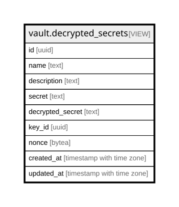

# vault.decrypted_secrets

## Columns

| Name | Type | Default | Nullable | Children | Parents | Comment |
| ---- | ---- | ------- | -------- | -------- | ------- | ------- |
| id | uuid |  | true |  |  |  |
| name | text |  | true |  |  |  |
| description | text |  | true |  |  |  |
| secret | text |  | true |  |  |  |
| decrypted_secret | text |  | true |  |  |  |
| key_id | uuid |  | true |  |  |  |
| nonce | bytea |  | true |  |  |  |
| created_at | timestamp with time zone |  | true |  |  |  |
| updated_at | timestamp with time zone |  | true |  |  |  |

## Viewpoints

| Name | Definition |
| ---- | ---------- |
| [vault schema](viewpoint-schema-vault.md) | All mapped relations in vault. |

## Relations

---

> Generated by [tbls](https://github.com/k1LoW/tbls)
