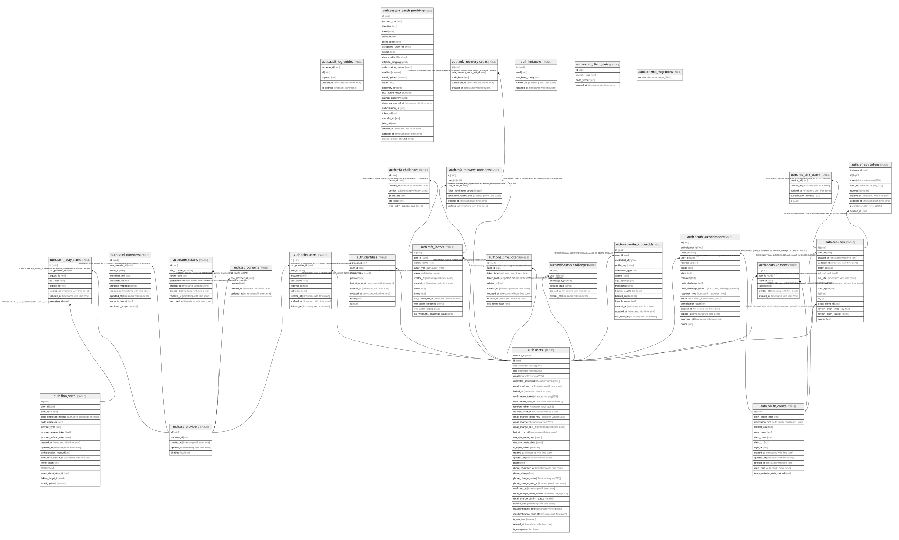

# auth schema

## Description

All mapped relations in auth.

## Tables

| Name | Columns | Comment | Type |
| ---- | ------- | ------- | ---- |
| [auth.audit_log_entries](auth.audit_log_entries.md) | 5 | Auth: Audit trail for user actions. | TABLE |
| [auth.custom_oauth_providers](auth.custom_oauth_providers.md) | 25 |  | TABLE |
| [auth.flow_state](auth.flow_state.md) | 17 | Stores metadata for all OAuth/SSO login flows | TABLE |
| [auth.identities](auth.identities.md) | 9 | Auth: Stores identities associated to a user. | TABLE |
| [auth.instances](auth.instances.md) | 5 | Auth: Manages users across multiple sites. | TABLE |
| [auth.mfa_amr_claims](auth.mfa_amr_claims.md) | 5 | auth: stores authenticator method reference claims for multi factor authentication | TABLE |
| [auth.mfa_challenges](auth.mfa_challenges.md) | 7 | auth: stores metadata about challenge requests made | TABLE |
| [auth.mfa_factors](auth.mfa_factors.md) | 13 | auth: stores metadata about factors | TABLE |
| [auth.mfa_recovery_code_sets](auth.mfa_recovery_code_sets.md) | 7 |  | TABLE |
| [auth.mfa_recovery_codes](auth.mfa_recovery_codes.md) | 5 |  | TABLE |
| [auth.oauth_authorizations](auth.oauth_authorizations.md) | 17 |  | TABLE |
| [auth.oauth_client_states](auth.oauth_client_states.md) | 4 | Stores OAuth states for third-party provider authentication flows where Supabase acts as the OAuth client. | TABLE |
| [auth.oauth_clients](auth.oauth_clients.md) | 13 |  | TABLE |
| [auth.oauth_consents](auth.oauth_consents.md) | 6 |  | TABLE |
| [auth.one_time_tokens](auth.one_time_tokens.md) | 9 |  | TABLE |
| [auth.refresh_tokens](auth.refresh_tokens.md) | 9 | Auth: Store of tokens used to refresh JWT tokens once they expire. | TABLE |
| [auth.saml_providers](auth.saml_providers.md) | 10 | Auth: Manages SAML Identity Provider connections. | TABLE |
| [auth.saml_relay_states](auth.saml_relay_states.md) | 8 | Auth: Contains SAML Relay State information for each Service Provider initiated login. | TABLE |
| [auth.schema_migrations](auth.schema_migrations.md) | 1 | Auth: Manages updates to the auth system. | TABLE |
| [auth.scim_tokens](auth.scim_tokens.md) | 8 |  | TABLE |
| [auth.scim_users](auth.scim_users.md) | 10 |  | TABLE |
| [auth.sessions](auth.sessions.md) | 15 | Auth: Stores session data associated to a user. | TABLE |
| [auth.sso_domains](auth.sso_domains.md) | 5 | Auth: Manages SSO email address domain mapping to an SSO Identity Provider. | TABLE |
| [auth.sso_providers](auth.sso_providers.md) | 5 | Auth: Manages SSO identity provider information; see saml_providers for SAML. | TABLE |
| [auth.users](auth.users.md) | 35 | Auth: Stores user login data within a secure schema. | TABLE |
| [auth.webauthn_challenges](auth.webauthn_challenges.md) | 6 |  | TABLE |
| [auth.webauthn_credentials](auth.webauthn_credentials.md) | 14 |  | TABLE |

## Relations

---

> Generated by [tbls](https://github.com/k1LoW/tbls)
