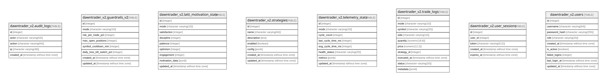

# dawntrader_v2 schema

## Description

All mapped relations in dawntrader_v2.

## Tables

| Name | Columns | Comment | Type |
| ---- | ------- | ------- | ---- |
| [dawntrader_v2.audit_logs](dawntrader_v2.audit_logs.md) | 5 |  | TABLE |
| [dawntrader_v2.guardrails_v2](dawntrader_v2.guardrails_v2.md) | 8 |  | TABLE |
| [dawntrader_v2.latti_motivation_state](dawntrader_v2.latti_motivation_state.md) | 9 |  | TABLE |
| [dawntrader_v2.strategies](dawntrader_v2.strategies.md) | 7 |  | TABLE |
| [dawntrader_v2.telemetry_state](dawntrader_v2.telemetry_state.md) | 8 |  | TABLE |
| [dawntrader_v2.trade_logs](dawntrader_v2.trade_logs.md) | 10 |  | TABLE |
| [dawntrader_v2.user_sessions](dawntrader_v2.user_sessions.md) | 5 |  | TABLE |
| [dawntrader_v2.users](dawntrader_v2.users.md) | 9 |  | TABLE |

## Relations

---

> Generated by [tbls](https://github.com/k1LoW/tbls)
