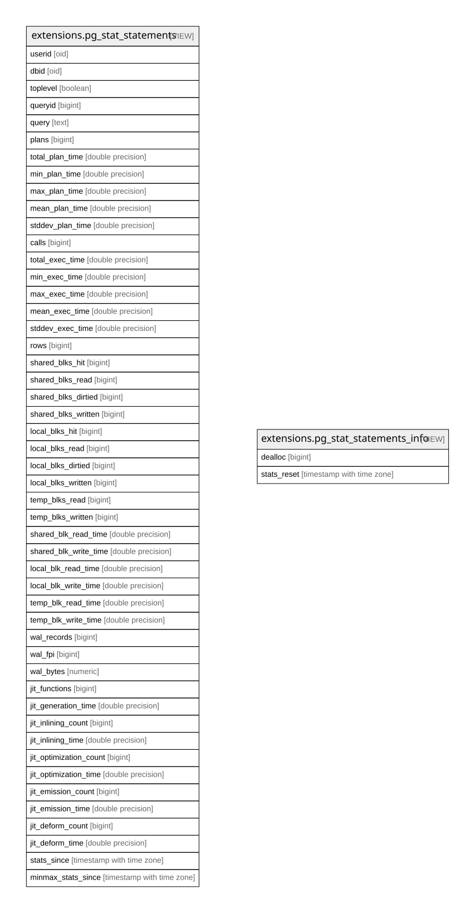

# extensions schema

## Description

All mapped relations in extensions.

## Tables

| Name | Columns | Comment | Type |
| ---- | ------- | ------- | ---- |
| [extensions.pg_stat_statements](extensions.pg_stat_statements.md) | 49 |  | VIEW |
| [extensions.pg_stat_statements_info](extensions.pg_stat_statements_info.md) | 2 |  | VIEW |

## Relations

---

> Generated by [tbls](https://github.com/k1LoW/tbls)
