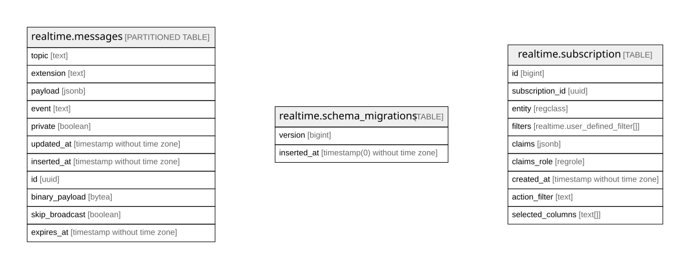

# realtime schema

## Description

All mapped relations in realtime.

## Tables

| Name | Columns | Comment | Type |
| ---- | ------- | ------- | ---- |
| [realtime.messages](realtime.messages.md) | 11 |  | PARTITIONED TABLE |
| [realtime.schema_migrations](realtime.schema_migrations.md) | 2 |  | TABLE |
| [realtime.subscription](realtime.subscription.md) | 9 |  | TABLE |

## Relations

---

> Generated by [tbls](https://github.com/k1LoW/tbls)
