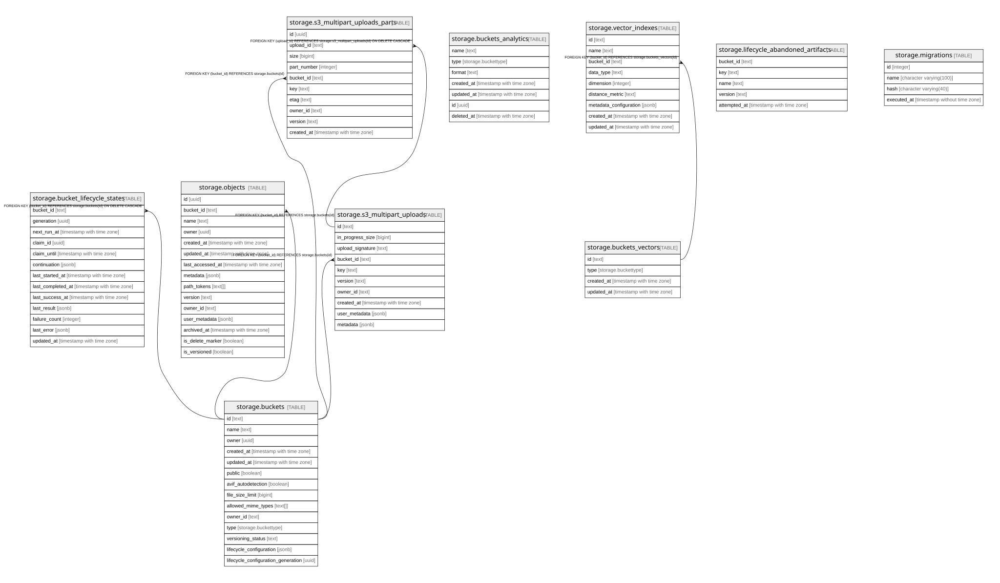

# storage schema

## Description

All mapped relations in storage.

## Tables

| Name | Columns | Comment | Type |
| ---- | ------- | ------- | ---- |
| [storage.bucket_lifecycle_states](storage.bucket_lifecycle_states.md) | 13 |  | TABLE |
| [storage.buckets](storage.buckets.md) | 14 |  | TABLE |
| [storage.buckets_analytics](storage.buckets_analytics.md) | 7 |  | TABLE |
| [storage.buckets_vectors](storage.buckets_vectors.md) | 4 |  | TABLE |
| [storage.lifecycle_abandoned_artifacts](storage.lifecycle_abandoned_artifacts.md) | 5 |  | TABLE |
| [storage.migrations](storage.migrations.md) | 4 |  | TABLE |
| [storage.objects](storage.objects.md) | 15 |  | TABLE |
| [storage.s3_multipart_uploads](storage.s3_multipart_uploads.md) | 10 |  | TABLE |
| [storage.s3_multipart_uploads_parts](storage.s3_multipart_uploads_parts.md) | 10 |  | TABLE |
| [storage.vector_indexes](storage.vector_indexes.md) | 9 |  | TABLE |

## Relations

---

> Generated by [tbls](https://github.com/k1LoW/tbls)
