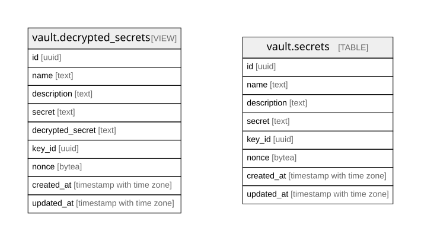

# vault schema

## Description

All mapped relations in vault.

## Tables

| Name | Columns | Comment | Type |
| ---- | ------- | ------- | ---- |
| [vault.decrypted_secrets](vault.decrypted_secrets.md) | 9 |  | VIEW |
| [vault.secrets](vault.secrets.md) | 8 | Table with encrypted `secret` column for storing sensitive information on disk. | TABLE |

## Relations

---

> Generated by [tbls](https://github.com/k1LoW/tbls)
